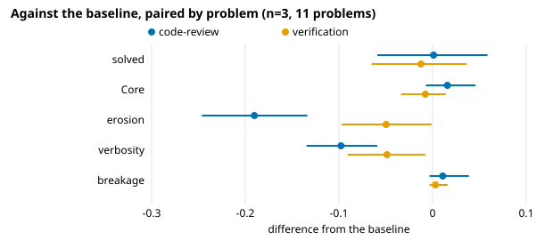
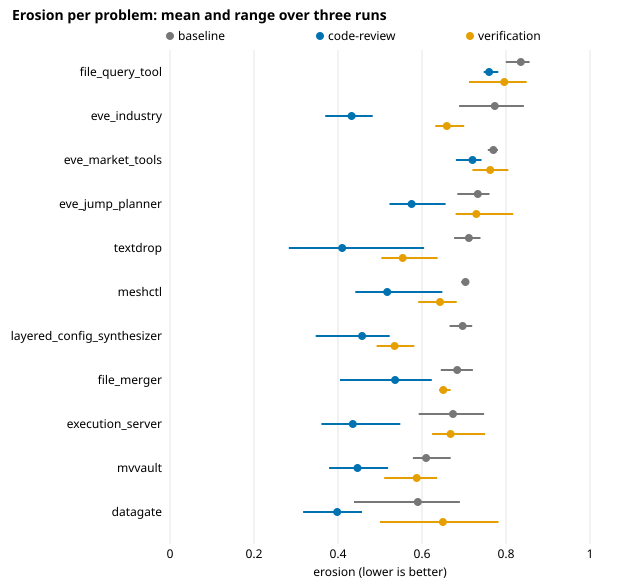

# Testing published agent skills, part 2: review and verify, what changed and what it cost

[Part 1](01-setup.md) covered the setup: SlopCodeBench, where an agent extends its own code over
three to eight checkpoints, run through Medrengard with Claude Opus 5.5 at medium effort. This
post covers the first two skills we tested, and what each one changed.

The short version: a review skill made the code clearly cleaner on every problem, didn't change
how much of it was correct, and cost about twice as much. A verification skill changed very
little.

## The two skills

We tested published, widely used skills rather than our own, copied word for word from a pinned
commit and run unedited.

**[`code-review`](https://github.com/mattpocock/skills/tree/4ae2317ddb22b046e26455e4f9c9b3aaaf62212d/skills/engineering/code-review)**
from Matt Pocock's `skills` repository (about 315k stars). It reviews a diff along two axes, each
in a fresh subagent so neither colours the other:

- **Spec**: does the code do what the spec asked? "Quote the spec line for each finding."
- **Standards**: does the code follow the repository's documented standards? On top of those,
  the reviewer always carries a fixed **smell baseline** of twelve of Fowler's code smells, each with
  its fix:

  > **Duplicated Code**: the same logic shape appears in more than one hunk or file in the change.
  > → extract the shared shape, call it from both.

  SlopCodeBench's problems come with no coding standards, so here the Standards reviewer works from
  the smell baseline alone.

The skill only reports findings. Pocock's own `implement` skill calls it at the end of its work.

**[`verification-before-completion`](https://github.com/obra/superpowers/tree/22f0b463e7a5e579904dd6211a520321035526f7/skills/verification-before-completion)**
from obra's `superpowers` (about 313k stars). There's no reviewer. Instead, the skill sets a
discipline for the agent itself:

> ```
> NO COMPLETION CLAIMS WITHOUT FRESH VERIFICATION EVIDENCE
> ```
>
> If you haven't run the verification command in this message, you cannot claim it passes.

It's mostly about honesty, not code quality. It asks for a command that proves each claim, and
lists the excuses agents make for skipping one ("I'm confident" → "Confidence ≠ evidence").

## How they ran

Each configuration is the baseline's single agent step with one change: a prompt that names the
skill, the skill itself, and only the tools the skill needs.

| configuration | prompt | tools added |
|---|---|---|
| baseline | Do what the request says, in your workspace. When you are done, commit all your work and claim the commit. | none |
| code-review | Do what the request says, in your workspace. When you are done, commit your work, then use the code-review skill to review it since the commit you started from, with the request as its spec. **Act on its findings**, then commit all your work and claim the commit. | `Agent`, for the subagent reviewers |
| verification | Do what the request says, in your workspace. Use the verification-before-completion skill before you claim your work is done. When you are done, commit all your work and claim the commit. | none |

"Act on its findings" is our addition. The skill only reports, and Pocock's `implement` doesn't say
to fix anything; without that phrase, the review would change nothing.

Before the study, a pilot ran each configuration once and checked from the transcripts that the
setup worked:

- Each checkpoint invoked its skill.
- code-review's two reviewers started as subagents, and the agent committed again after them.
- Claude Code's cost estimate includes the subagents.

The study then ran the baseline, code-review and verification three times each on eleven problems,
with the baseline run alongside as a fresh control. Every run completed. One checkpoint was run
again after a fault in our harness, not the agent's: the agent's tests left a directory our
cleanup couldn't remove.

## What changed



Paired by problem against the baseline, n=3, eleven problems, bootstrap 95% intervals:

| | solved | Core | erosion | verbosity | breakage | $ per problem |
|---|---|---|---|---|---|---|
| baseline | 0.697 | 0.855 | 0.707 | 0.358 | 0.002 | 3.20 |
| code-review − baseline | +0.001 [−0.059, 0.059] | +0.016 [−0.007, 0.046] | **−0.190 [−0.246, −0.134]** | **−0.098 [−0.135, −0.059]** | +0.011 [−0.003, 0.039] | +3.69 (2.2×) |
| verification − baseline | −0.012 [−0.065, 0.036] | −0.008 [−0.034, 0.014] | −0.050 [−0.097, −0.001] | −0.049 [−0.091, −0.008] | +0.003 [−0.003, 0.016] | +0.80 (1.25×) |

### code-review: much cleaner code, no change in correctness

Erosion fell by 0.19, from 0.71 to 0.52. In rough terms: in the baseline, about seven tenths of the
code's complexity, weighted by function size, sits in functions too tangled to follow easily (cyclomatic complexity above 10).
With the review, it's about half. Verbosity, the share of duplicated or boilerplate lines, fell by
a quarter.

This wasn't a few problems pulling the average. Erosion was lower on every one of the eleven:



The size varied a lot: from −0.05 on eve_market_tools and −0.07 on file_query_tool to −0.30 on
textdrop and −0.34 on eve_industry.

Correctness didn't move. Solved changed by +0.001, and its interval rules out any change bigger
than about six points either way. Per problem, the differences were small and went both ways
(mvvault −0.11, eve_jump_planner +0.11), within what three runs can tell apart.

Test by test, it looks the same. Across every checkpoint of every problem, only two test families
separate code-review from the baseline consistently, meaning every code-review run passes them and
every baseline run fails them, or the other way round. Both are textdrop's input-validation tests
(rejecting a JSON submission with a missing or wrong key, and rejecting invalid render payloads),
and code-review passes both. Nothing goes the other way.

Nor did cleaner code protect against regressions. **Breakage**, the share of tests that passed at
their own checkpoint and fail at a later one, is tiny for every configuration and doesn't differ
from the baseline's (+0.011 [−0.003, 0.039]). Part 4 shows why: there's almost nothing to break.

### verification: little change

Erosion and verbosity fell by about 0.05 each, at the edge of their intervals, and correctness
didn't change. The skill says nothing about code structure, and the code came out much like the
baseline's. Two problems, textdrop and layered_config_synthesizer, fell by 0.16; datagate went up
by 0.06.

## What it cost

| | $ per problem run | minutes per problem run |
|---|---|---|
| baseline | 3.20 | 14 |
| code-review | 6.89 (2.2×, from 1.8× to 2.9× per problem) | 27 |
| verification | 4.00 (1.25×) | 18 |

Costs are Claude Code's own estimate at API prices, for a whole problem run (every checkpoint),
and include the reviewer subagents. Times are wall time on a machine doing other work at the same
time, so treat them as rough.

So code-review roughly doubles both spend and time, and what it buys is structure, not
correctness. Whether that's worth it depends on whether cleaner code pays off later. Within
SlopCodeBench's horizon, part 4 shows it doesn't get the chance.

## What neither skill fixed

The baseline gets some checkpoints wrong in the same way in every run, and so do both skills.
datagate's checkpoint 2 is the clearest case. The tests number rows by their line in the source
file, with the header as line 1, and all nine runs, three per configuration, number them from the
first data row instead, failing the same three tests. In a pilot run, code-review's Spec reviewer
flagged the numbering as doubtful, and the agent kept its reading. The spec's sentence ("1-based
source-file row number") honestly allows both. A reviewer that's the same model, reading the same
spec, tends to settle an ambiguity the same way. Part 5 finds that most of the failures every run
shares are like this, or worse: places where the spec is silent or contradicts its own tests.

## What we can't say from this

- **Which part of code-review does the work.** The configuration adds a prompt, a skill and a tool
  at once. Part 3 shows that most of the drop in erosion is already there before the review runs,
  which makes this question sharper.
- **Anything about other models.** A different model might respond to the same skill differently.
- **Small effects.** With three runs, the study can detect a difference of about 0.05 in solve rate;
  smaller ones would go unseen.

Next: reading the diffs, to see whether the reviewed code is actually better.
