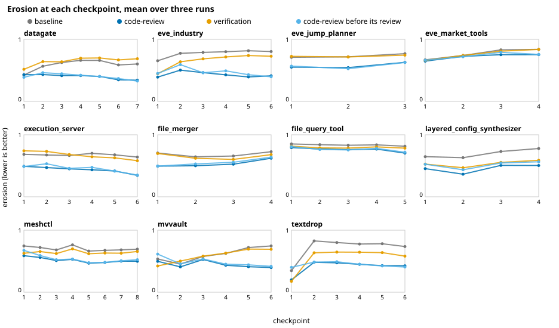

# Testing published agent skills, part 3: reading the diffs

[Part 2](02-review-and-verify.md) found that Matt Pocock's `code-review` skill lowered erosion by
0.19 on every problem, left correctness unchanged, and cost about twice as much. A metric moving
isn't the same as code getting better, though. This post opens the commits to see what the
reviews actually changed, and whether we'd call the result better.

Every code-review checkpoint ends with two commits: the agent's work, then a commit addressing the
review. So for each of the 177 checkpoints we have the code just before the review and just after
it. We measured both with SlopCodeBench's own quality tool, graded both with its own tests, and
read the reviewers' reports from the transcripts.

## Most of the gain isn't in the review's diff

The first surprise: measured at the same checkpoint, the review itself moves erosion only a
little, from 0.53 to 0.50 on average. It lowered erosion at 114 of the 177 checkpoints and raised
it at 61. Yet by the end of a problem, code-review's code is 0.23 below the baseline's.



The light blue line is code-review's code just before each review. It sits close to the dark blue
line, the code after the review, and well below the baseline almost everywhere. Paired by problem,
against the baseline:

| | checkpoint 1 | checkpoint 2 |
|---|---|---|
| code-review, before its review | −0.08 [−0.14, −0.03] | −0.14 [−0.19, −0.09] |
| code-review, after its review | −0.13 | −0.17 |
| verification | −0.06 [−0.11, −0.00] | −0.04 |

Two things are going on.

**Before any review has run, the code is already a little cleaner.** At checkpoint 1 no review has
happened yet, and code-review's code is 0.08 below the baseline. That's about the same as
verification's 0.06, a skill that says nothing about structure. So part of the effect seems to come
from the agent being given a skill and a longer prompt at all, not from anything review-specific.
At checkpoint 1 of eve_industry, for instance, the baseline puts its data loading into one
function of 100 to 150 lines; code-review's code, before its review, keeps that function to 50 to
70 lines, and verification's mostly falls in between.

**After that, the reviews compound.** From checkpoint 2 on, "before the review" means the previous
checkpoint's reviewed code plus new work. Each review's few hundredths of erosion get carried
forward, and new work is written into code that's already been tidied once. The baseline's
erosion drifts up across checkpoints; code-review's stays flat or falls.

We can't fully separate these with this study. The configuration adds a prompt, a skill and a
subagent tool at once. Running the baseline with only the tool added, or with a prompt that
mentions a review that never happens, would tell them apart.

## What the reviews change

Each review runs two reviewer subagents. **Spec** checks the work against the request, quoting
it. **Standards** checks it against a list of Fowler's code smells, since these problems have no
documented coding standards. Then the agent decides what to act on. Reading the reports alongside
the diffs, the biggest changes come from both.

### Removing what nobody asked for

textdrop, repeat 3, checkpoint 1: a 26-line review diff that roughly halved erosion, from 0.53 to
0.25. It wasn't a refactor. The Spec reviewer flagged two behaviours the spec never asked for:

> *"Any request to a path not matching a defined route returns HTTP 404"*: requests to a route that
> exists but with the wrong method get **405** with an `Allow` header … The spec doesn't define this
> status.

> *"Accepts `application/x-www-form-urlencoded` input"*: any other Content-Type is rejected with
> 400 … The spec doesn't say to reject other types.

The agent removed both:

```diff
-        allowed = {"editor": ("GET", "POST")}.get(route, ("GET",))
-        if route == "editor" and arg == "/":
-            allowed = ("GET",)
+        allowed = ("GET", "POST") if arg == "/submit" else ("GET",)
         if method not in allowed:
-            allow = ", ".join(allowed + (("HEAD",) if "GET" in allowed else ()))
-            return self._error(
-                405, "Method Not Allowed",
-                f"The {self.command} method is not allowed for this URL.",
-                {"Allow": allow},
-            )
+            # A route is a method + path pair; anything else is unregistered.
+            return self._not_found()
```

With those branches gone, one of the two functions above the complexity threshold that erosion
counts dropped below it, and the metric halved. Is the code better? It's simpler and closer to the spec.
Whether a 405 is better HTTP than a 404 is a separate argument, and the spec settled it.

The Standards reviewer, in the same review, called the `mode` field check speculative ("a hook for
a feature that doesn't exist. Delete it unless the spec requires it"). The spec does require it,
and the agent kept it. Its main suggestion, replacing a cascade of `if route == ...` with a route
table, wasn't taken up.

### Consolidating rules written twice

mvvault, repeat 2, checkpoint 1: the largest drop of any single review, from 0.66 to 0.32. Here the
agent followed the Standards reviewer:

> **Duplicated Code, Repeated Switches and Shotgun Surgery (field type rules).** The per-field type
> rules are written twice … Adding a tracked field means editing `TRACKED_SOURCE_FIELDS`, both
> validators and possibly `apply_sync`. One shared map from field name to validator would fix this.

```diff
-def _valid_tracked_value(field, value):
-    if field in ("title", "description", "preview"):
-        return isinstance(value, str)
-    if field == "views":
-        return _is_int(value)
-    if field == "likes":
-        return value is None or _is_int(value)
-    if field == "removed":
-        return isinstance(value, bool)
-    return False
+FIELD_TYPES = {
+    "id": (_is_str, "a string"),
+    "published": (_is_str, "a string"),
+    "width": (_is_int, "an integer"),
+    ...
+    "likes": (_is_int_or_null, "an integer or null"),
+    "removed": (_is_bool, "a boolean"),
+}
```

One table instead of two hand-written validators, and a shared helper for a loop that appeared
twice. This is the kind of change a human reviewer would ask for, and we'd call the result better:
a new field is now one line.

The same review also changed behaviour on the Spec reviewer's say-so. Timestamps with a timezone
had been converted to UTC; now the suffix is dropped and the wall-clock time kept. The reviewer
called its own reading "debatable but likely wrong". The tests didn't distinguish the two.

### Across all 177: shorter code, more and smaller functions

By the last checkpoint, averaged over problems:

| | baseline | code-review | code-review lower on |
|---|---|---|---|
| erosion | 0.74 | 0.51 | 11 / 11 problems |
| cognitive erosion | 0.89 | 0.72 | 11 / 11 |
| verbosity | 0.37 | 0.26 | 11 / 11 |
| lines | 1486 | 1371 | 10 / 11 |
| functions | 85 | 111 | 0 / 11 |
| functions with complexity above 10 | 16.3 | 11.6 | 10 / 11 |

Erosion is a share of complexity sitting in complex functions, so splitting functions lowers it
almost by definition. A skeptic could suspect the metric is just being gamed by chopping code into
pieces. The other rows argue against that: the code is shorter overall, not longer; there are a
third fewer tangled functions; and cognitive erosion, a measure based on how hard code is to read,
falls just as consistently.

## Do the reviews make code more correct?

Mostly they don't touch correctness, but sometimes they do. We graded every commit just before a
review with the same tests the study used:

| | checkpoints |
|---|---|
| review fixed at least one test | 12 of 177 |
| review broke at least one test | 7 of 177 |
| unsolved → solved | 3 |
| solved → unsolved | 1 |

By test family (a parametrized test's cases counted once), the reviews fixed 23 families of their
own checkpoint's tests and broke 9. In cases, 33 fixed and 11 broken, of which 7 and 1 were Core
tests. No review changed an earlier checkpoint's test. On five of the eleven problems, no review
changed a single test result.

That fits part 2: a reviewer that's the same model reading the same spec rarely finds a failure the
implementer missed. When it does, it's mostly at the first checkpoint, where the program is new.

### When the review catches a real miss

datagate, repeats 2 and 3, checkpoint 1. Before the review, 7 tests failed; after it, 1, in both
runs. In repeat 3 the Spec reviewer found several requirements handled loosely, and the agent fixed
them: single-column CSVs, rows with more fields than the header, protocol errors returned in the
JSON error format, an empty `charset` treated as omitted. The checkpoint went from unsolved to
solved.

Erosion went *up*, from 0.40 to 0.51, because the fixes added branches. Correct code was more
complex code here, and the metric marks it down.

### A correction: no safety net

An earlier draft of this post reported that datagate's reviews kept restoring a family of 27 error
tests that each checkpoint's new work had broken, 155 test results in all. That came from our own
measurement. The first pass of grading the commits before each review ran while the machine's
temporary storage was full, and some grades recorded failures that weren't there. Graded again,
with everything else unchanged, those commits pass the tests. Three commits the study had already
graded, regraded the same way, matched the study's grades exactly. The figures above are from the
clean regrade. No review in the study fixed or broke an earlier checkpoint's test.

### When the review makes things worse

file_merger, repeat 3, checkpoint 1, the one review that cost a solved checkpoint. The Spec
reviewer argued that the type inference followed the spec's letter but not its intent:

> In my test, `e.csv` (0,1) plus `f.csv` (10,2) gave output order `0,1,10,2`, a string sort of a
> numeric key. … A literal reading of the spec allows this, but bool vs int is very unlikely to be
> the intended "conflict".

The agent reworked inference: a column of only 0s and 1s now infers as `int` rather than `bool`,
and a mix of bare dates and timestamps widens to timestamps. The new `pick_type` function documents
all this carefully. One Core case, `cross_family_coercion`, broke: the tests wanted the literal
reading.

A reviewer arguing for what the spec "must have meant" can be persuasive and wrong.

### When the review fixes something and the next checkpoint undoes it

layered_config_synthesizer, repeat 3. At checkpoint 1 the review fixed 9 tests, taking Core from
3/8 to 8/8. The fix that mattered was one line:

```diff
-    warn_text = "".join(w + "\n" for w in warnings)
+    # With no warnings the file holds just a trailing newline.
+    warn_text = "".join(w + "\n" for w in warnings) or "\n"
```

At checkpoint 2, the agent's new work changed it back to an empty file, and exactly those 9 tests
failed again. Checkpoint 2's Spec reviewer noticed the reversal and approved it: *"That reverses
commit 40f4fcc but matches Part 2: 'Leave the file empty (0 bytes) only if there are no
warnings.'"*

The reviewer was right about the spec, and the spec is wrong about its own tests. Every expected
`warnings.txt` in the problem's tests, at every checkpoint, is a single newline. This is the
largest breakage in this study (39% of checkpoint 1's tests at checkpoint 2), and it's not decay or
carelessness: the agent did what the new spec said. Part 5 comes back to spec gaps like this one.

## Is the reviewed code better?

Our reading, case by case:

- **Better, clearly:** consolidating duplicated rules into one table (mvvault), removing behaviour
  nobody asked for (textdrop), fixing requirements the first pass handled loosely (datagate). These
  are what we'd ask for in a human code review.
- **Better, and the metric understates it:** datagate's fixes made the code more correct and more
  complex. Erosion went up.
- **Worse, sometimes:** reviews broke 9 test families at 7 checkpoints, against 23 fixed at 12.
  Only one cost a solved checkpoint: file_merger's reworked inference, argued from the spec's
  supposed intent.
- **Neutral:** most reviews. On five of eleven problems no review changed a test result, and most
  diffs are renames, extracted helpers and docstrings that a reader would find slightly easier
  going.

Across all problems, the code that code-review produces is shorter, has more and smaller functions,
and has a third fewer tangled ones. That's a real improvement in structure. But most of it builds
up across checkpoints rather than arriving in any single review, and it doesn't show up as more
problems solved. Part 4 looks at why.

## Caveats

- **We read a handful of diffs closely,** chosen for being the largest or most unusual by the
  numbers, not at random.
- **"Better" is our judgement.** The diffs and the reviewers' reports are reproducible with
  `writeup/diffs.ts show` and `writeup/diffs.ts findings`, so readers can make their own.
- **One model, three runs per problem,** as throughout.
