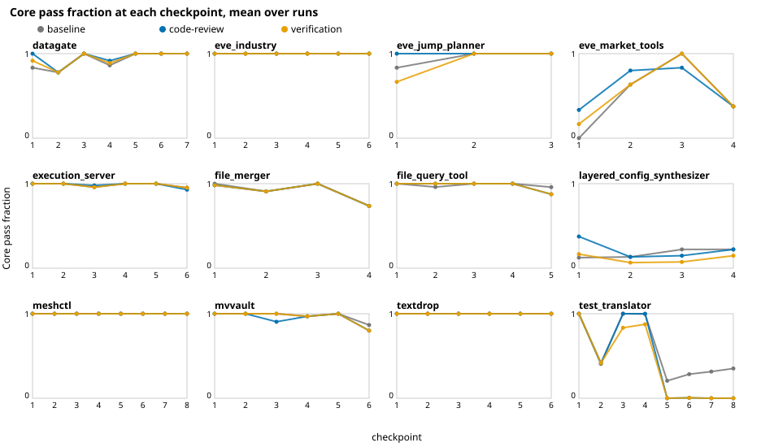

# Testing published agent skills, part 4: why cleaner code doesn't raise the solve rate

[Part 2](02-review-and-verify.md) found that a review skill made the code much cleaner and left
correctness exactly where it was. [Part 3](03-reading-the-diffs.md) found the cleaner code is real:
shorter, with a third fewer tangled functions. So why doesn't it get more right?

The usual argument for clean code is about change. Tangled code is harder to modify without
breaking something, so over many changes, a messy codebase accumulates regressions and a clean one
doesn't. SlopCodeBench is built to test exactly this: the agent extends its own code over up to
eight checkpoints, and every checkpoint reruns the earlier checkpoints' tests.

For cleaner code to pay off, the messier code has to break things. So we measured how often it
does.

## Measuring breakage

At each checkpoint, SlopCodeBench reruns every earlier checkpoint's tests in a **Regression**
group. We define **breakage** at a checkpoint as: of the tests each earlier checkpoint passed when it
was first graded, the share that now fail. A test that never passed doesn't count, since there was
nothing to break.

## The agent almost never breaks what it built

Across every run we have (the baseline five times on twelve problems, once on 24 more, and the
review and verify study's nine runs per problem), leaving out two problems we come back to below:

| | checkpoints | broken / earlier tests that had passed | mean breakage |
|---|---|---|---|
| all runs | 653 | 37 / 57,862 | 0.07% |
| review-verify, baseline | 120 | 12 / 10,327 | 0.16% |
| review-verify, code-review | 120 | 8 / 10,489 | 0.07% |
| review-verify, verification | 120 | 5 / 10,384 | 0.04% |

Thirty-seven test results broken out of nearly 58,000 checked. The largest single case is 3 of 48
tests at one checkpoint of one survey problem.

It doesn't grow with the horizon, either:

| at checkpoint | 2 | 3 | 4 | 5 | 6 | 7 | 8 |
|---|---|---|---|---|---|---|---|
| broken / checked | 3 / 5,200 | 7 / 9,637 | 10 / 13,588 | 12 / 15,161 | 5 / 7,729 | 0 / 5,652 | 0 / 895 |

There's a slight rise through checkpoint 5 and none after. Checkpoints 7 and 8 come from only a
few problems, but they're the longest-lived code in the benchmark, and nothing broke there.

The baseline breaks a little more than code-review in the study (12 test results against 8), in
the direction the clean-code argument predicts. But it's a difference of four tests in ten
thousand, too small to move any checkpoint from solved to unsolved.

## "Regression" scores fall anyway, and it isn't regression

If you look at SlopCodeBench's Regression pass rate per checkpoint, it does fall over a problem.
That looks like decay, but it isn't. Of the 4,311 Regression failures in these runs, 4,274 (99.1%)
are tests that **never passed** at their own checkpoint. A test failed at checkpoint 2 fails again
in checkpoint 3's Regression group, and 4's, and so on, so one early miss gets counted again at
every later checkpoint. The Regression score tracks old misses piling up, not new breakage.

## Correctness by checkpoint: no collapse

Core pass rate per checkpoint shows the same thing. Most problems stay at or near 1 throughout.
Where a checkpoint dips, the three configurations dip together and recover together: datagate
at checkpoint 2, file_merger at checkpoints 2 and 4, eve_market_tools at 4. The same tests fail in
every configuration. When every run gets a checkpoint wrong in the same way and then recovers at
the next one, the problem is in how that checkpoint's spec is read, not in the code decaying.

Only one panel collapses: test_translator, where every configuration falls to near zero from
checkpoint 5 and stays there. That's the first of the two problems left out above.

## The two exceptions

Two problems do show heavy breakage, and in both cases it comes from the specification, not from
the code getting worse.

- **test_translator**: in five of the eight runs we have, 63–84% of earlier tests broke at
  checkpoint 5 and stayed broken; one run broke 7–12%, and two broke none. Checkpoint 5's spec
  changes which files count as tests in a way that makes earlier cases fail, unless the program
  skips one particular file that the spec never mentions. The one run that solved checkpoint 5
  happened to skip it.
- **layered_config_synthesizer**: up to 39% breakage at checkpoint 2. Checkpoint 2's spec says an
  empty `warnings.txt` must be zero bytes; every test at every checkpoint expects a single newline.
  Agents that follow the new spec break the earlier tests. Part 3 shows one run doing exactly this,
  with the reviewer's approval.

Part 5 covers both.

## So why doesn't cleaner code show?

Putting it together:

1. Clean code's payoff is fewer regressions as code changes.
2. Within SlopCodeBench's horizon, this model makes almost no regressions, clean code or not:
   0.16% for the baseline, 0.07% for code-review.
3. The failures that do happen are at a checkpoint's first attempt, the same in every
   configuration, and mostly where the spec is ambiguous or disagrees with its tests (part 5).
   Structure has nothing to do with them.

The baseline's erosion does climb across checkpoints, from 0.63 at checkpoint 1 to 0.75 at
checkpoint 4 averaged over problems, in line with what SlopCodeBench was built to show. But at eight checkpoints of a few
thousand lines, the messier code is still easy enough for this model to change without breaking.
Code-review's cleaner code has nothing to save it from.

That doesn't mean the cleanliness is worthless. It means this benchmark can't see its value. A
human maintainer, a longer project or a weaker model might all see it, and none of those are
measured here.

## Where a longer horizon would show it

Other benchmarks run agents over longer, real histories:

- [**SWE-EVO**](https://arxiv.org/abs/2512.18470) asks agents to carry a real repository from one
  release to the next, a change spanning many files and features.
- [**EvoClaw**](https://arxiv.org/abs/2603.13428) runs agents through 98 milestones of seven
  open-source repositories' histories (ripgrep, scikit-learn, nushell and others), with each
  milestone building on the agent's own earlier work. Its headline finding is the opposite of ours:
  agents add features but keep breaking existing code.

The contrast is the interesting part. Real repositories are larger, older and carry other people's
decisions; SlopCodeBench's problems start from nothing and stay small. If structure pays off, a
benchmark like EvoClaw is where it would show. We haven't run either, and comparing them with ours
would be a study of its own.

## Caveats

- **One model.** Opus 5.5 at medium effort. A weaker model might break much more, and then clean
  code might matter.
- **SlopCodeBench's horizon.** At most eight checkpoints and a few thousand lines. "No decay" is a
  finding about this horizon only.
- **Breakage is measured by the benchmark's tests.** Something broken that no test checks wouldn't
  show up.
- **l2m** has no Regression tests, so it's the one problem we ran whose breakage we couldn't
  measure.

Next: where the failures do come from.
