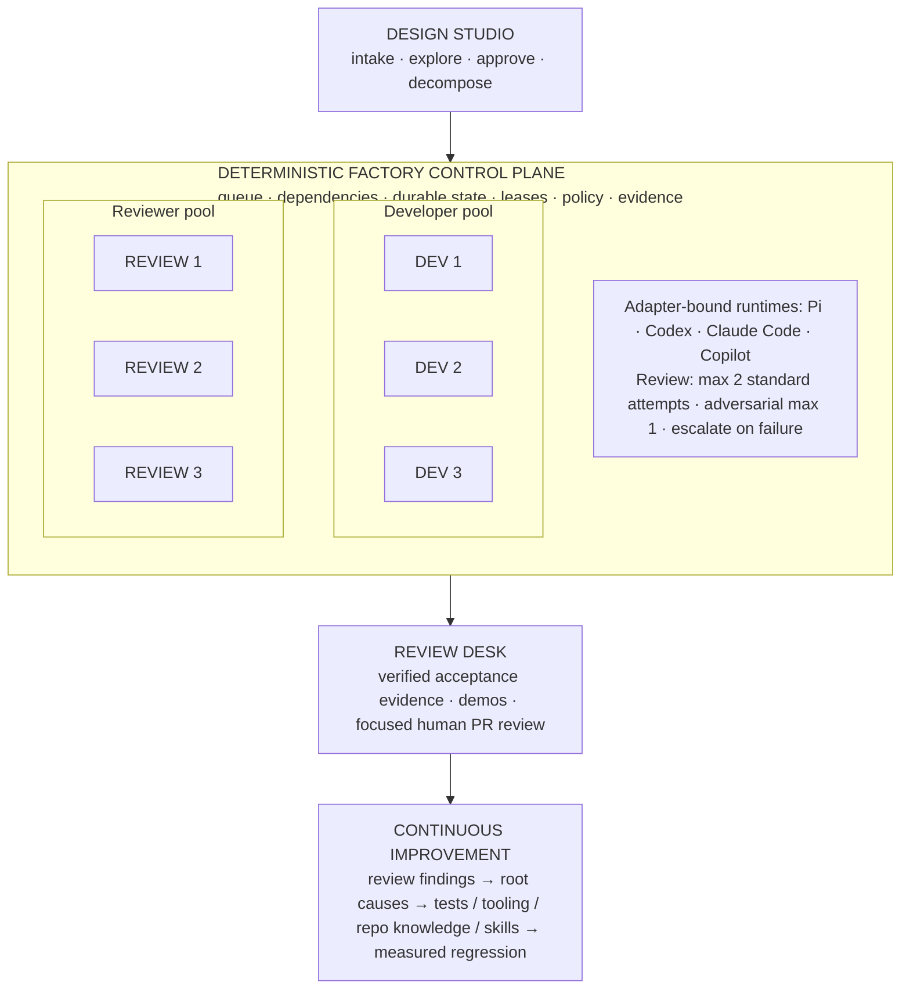
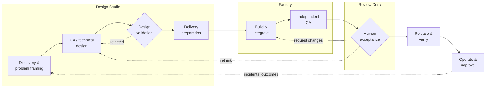
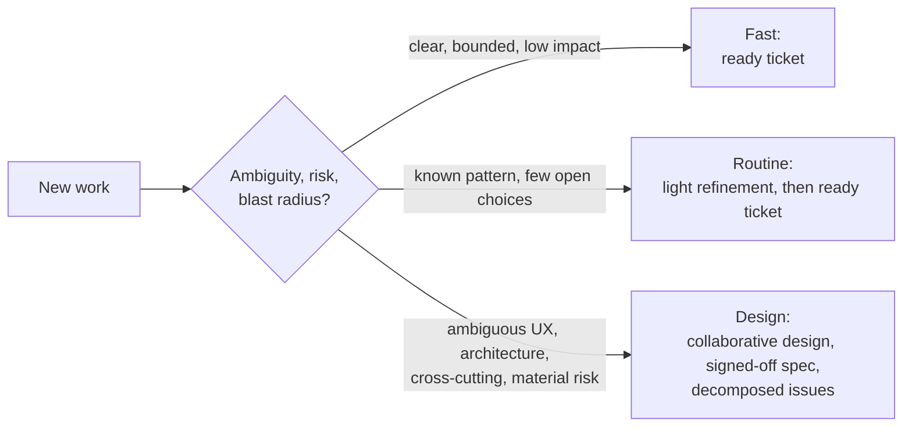
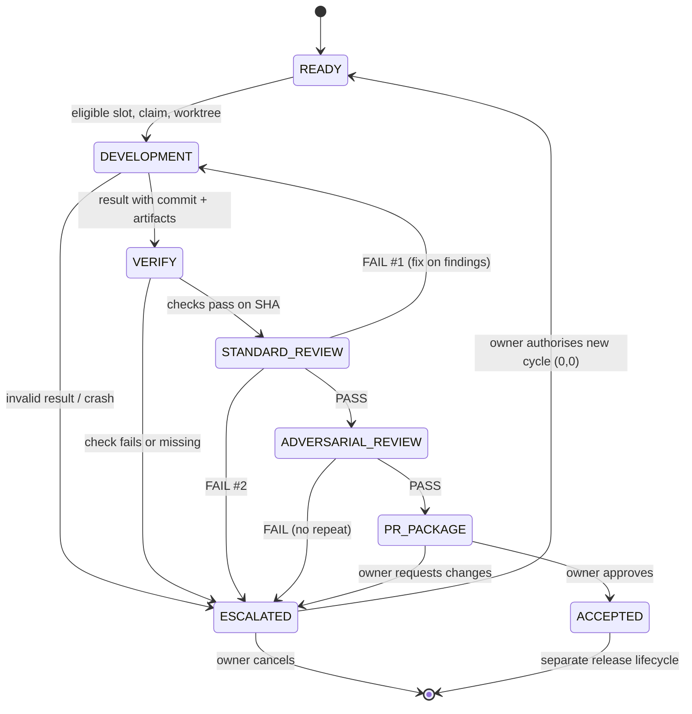
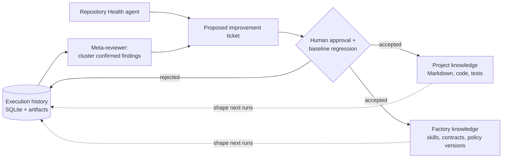
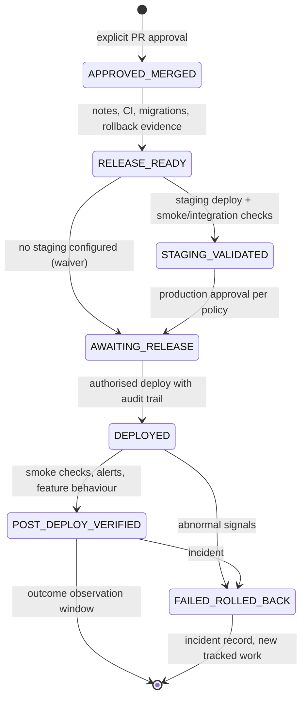
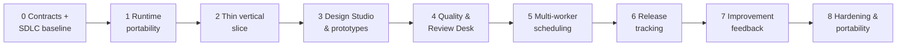

# AI Software Factory: Architecture and Implementation Plan

Markdown conversion of the original design document (the DOCX is in Git history at `c3f91f9`). Content is unchanged except that figures and state tables are also rendered as Mermaid diagrams.

> **PURPOSE**  
> A practical, vendor-neutral design for collaborative requirements, autonomous development, bounded independent review, evidence-led acceptance, and continuous improvement.

| Document control | Value |
| --- | --- |
| Version | 0.3 — SDLC-complete working design |
| Date | 15 October 2026 |
| Status | Proposed architecture for technical review and iterative implementation |
| Supersedes | Version 0.2; retains vendor-neutral architecture, bounded reviews and improvement loop |
| Audience | Owner, implementers, engineering reviewers |

> Conventions: DECIDED = direction explicitly chosen in discussion; PROPOSED = recommended implementation detail; OPEN = requires confirmation. This document is a design, not proof that a runtime supports any particular enterprise configuration.

### What changed in v0.3

- Added explicit end-to-end SDLC coverage and risk-based tailoring: discovery, design validation, development, independent QA, release and learning.
- Formalised UX wireframes/mockups, interactive prototypes and technical spikes with trigger conditions, review artifacts and design approval.
- Expanded Ready-for-Work contracts to capture approved UX evidence, success measures, quality profiles and release impact.
- Added an independent QA strategy: layered automated checks, visual/accessibility/security/performance requirements and product acceptance.
- Added release readiness, staging checks, production approval, rollback/recovery, post-deploy smoke tests and operational feedback; automatic production deployment remains out of initial scope.
- Updated implementation roadmap, open decisions and controller acceptance tests to cover the full delivery lifecycle.

## 01  Executive summary

The current workflow already uses three largely successful coding streams, currently coordinated through Herdr and Superpowers-inspired skills. The bottleneck is operational: issues are assigned in batches and human input is required to advance the orchestrators through their stages. The redesign addresses this with a durable deterministic control plane, not an additional supervisory LLM.

The owner should spend time upstream on problem discovery, UX exploration, prototyping and acceptance of solution designs, and downstream on reviewing demonstrated outcomes and release decisions. Between those points, goal-oriented tickets flow through portable implementation agents, independent quality gates and bounded review. Approved changes can then follow a release policy, while production evidence feeds Continuous Improvement. Not every issue requires every activity; a risk-based profile selects the necessary work.

> **TARGET OPERATING MODEL**  
> Design collaboratively → approve a versioned specification → issue small, verifiable delivery contracts → factory schedules agents → independent verification with strict review budgets → human reviews a focused evidence package → improvement loop prevents repeat defects.

### Decided direction

- Four conceptual capabilities: Design Studio, deterministic Factory, Review Desk and Continuous Improvement. These do not initially require four separate applications.
- Controller owns the issue lifecycle, scheduling, queue, durable state, monitoring, review limits and escalation; LLM agents own reasoning and implementation.
- Three concurrent development slots; two or three concurrent reviewer slots, implemented as pools rather than permanent teams.
- Maximum two standard review attempts per delivery cycle, and one adversarial review attempt; failures at the limit require human intervention.
- Tickets define a goal, observable “Done when” checks, constraints and approved design context.
- Vendor/system portability across Pi, Codex, Claude Code and GitHub Copilot, with separate corporate and personal execution contexts.
- Human approval for final PR acceptance and for substantive changes to approved intent or the factory’s own governing rules.
- Formalise the full software lifecycle without turning it into a waterfall: discovery and validation are proportional to uncertainty; implementation/review remain autonomous; release and production feedback are modelled even when execution is initially manual.

### Key technical proposals

- Use TypeScript initially for the core and CLI/SDK adapters, SQLite for local durable state, and GitHub Issues/PRs for human-visible work and decisions.
- Use isolated Git worktrees, machine-readable artifacts and verified commit-bound evidence; do not require native agent-session resumption.
- Use portable SKILL.md skills and version-controlled repository knowledge; start with normal search before adding embeddings or a vector database.
- Keep the product’s first review experience in GitHub PRs rather than building a custom web dashboard.
- Treat meta-review suggestions as proposed work, not automatic edits to skills, security policy, quality gates or orchestration rules.

### Non-goals for initial release

A new agent runtime; centralised credential sharing; automatic production deployments in the first release; unrestricted merges; large cross-repository scheduling; a general-purpose semantic memory service; autonomous policy changes. The release *workflow* and its evidence are in scope even while deployment remains manual.

## 02  Architecture and ownership

Each subsystem has a crisp contract. Only the deterministic controller may advance work-state transitions and spend review budgets; agents supply proposals, code and evidence. Product acceptance and policy changes require explicit human decisions.



> Figure 1. Target architecture. The Continuous Improvement layer reads the lifecycle’s evidence and feeds versioned improvements into repositories, skills and tooling; it is not a mandatory inline PR gate.

| System | Owns | Does not own |
| --- | --- | --- |
| Design Studio | Intake, interactive exploration, approved specifications, issue decomposition | Unapproved changes to scope; agent execution scheduling |
| Factory core | Queue, dependencies, leases, policy, dispatch, verification, review budgets, escalation | Technical design choice; reinterpretation of accepted acceptance criteria |
| Agent adapters | Runtime-specific start, observe, cancel, artifact/result handling | Core lifecycle semantics or organisation policy |
| Developers / reviewers | Implementation and independent quality assessment | Authoritative acceptance, governance changes, review-counter reset |
| Review Desk | Evidence presentation, owner decisions and PR disposition | Inferring approval from successful tests alone |
| Continuous Improvement | Analysis of findings, repository health, proposals and evaluations | Directly loosening gates or rewriting its own governing prompts |

### End-to-end SDLC and ownership



The four conceptual capabilities own a continuous delivery lifecycle rather than only issue-to-PR code generation. The sequence below is logical, not a mandatory waterfall; small tasks may bypass exploratory activities while high-risk work may revisit earlier decisions.

| Activity | Owning capability / gate | Required evidence |
| --- | --- | --- |
| Discovery & problem framing | Design Studio | Problem, users, assumptions, desired outcome |
| UX / technical design | Design Studio | Mockups, prototypes/spikes and decisions when warranted |
| Design validation | Design Studio + human | Accepted design version; user feedback when available |
| Delivery preparation | Design Studio / issue gate | Bounded goal, Done when, dependencies, quality profile |
| Build & integrate | Factory / developer pool | Commit, tests, build, implementation artifacts |
| Independent QA | Factory / CI + reviewers | Commit-bound automated evidence and review verdicts |
| Human acceptance | Review Desk | Demo, acceptance matrix, explicit disposition |
| Release & verify | Release policy / authorised operator | Release candidate, deployment evidence, smoke tests |
| Operate & improve | Continuous Improvement | Incidents, product outcomes, recurring defects, proposals |

### SDLC tailoring rule

Classify work along ambiguity, UX impact, technical uncertainty, security/data sensitivity, blast radius and reversibility. The controller enforces the selected required artifacts and gates; workers may add more investigation but cannot waive required gates.

- Trivial: explicit goal and done-when evidence; usually skip discovery sessions, prototypes and human design approval unless risk dictates otherwise.
- Routine: confirm UX/API conventions and acceptance scenarios; use a lightweight design review or prototype only when behaviour is uncertain.
- Complex/high-risk: explicit discovery and solution rationale, relevant UX mockups/prototypes or feasibility spikes, human approval, expanded verification, and release-impact assessment.

## 03  Design Studio: upstream collaboration

### Discovery: validate the problem before selecting a solution

For substantive work, first identify who is affected, the current workflow, observed pain, assumptions, constraints and what success would look like. The agent may help inspect repository/product evidence, analyse feedback and research alternatives, but it must distinguish observed user evidence from inferred preferences.

- Record problem statement, target users and top assumptions; mark any assumption requiring actual user validation.
- Define intended product outcomes or observable success signals before choosing an implementation.
- For small or well-understood issues, capture the short rationale and proceed directly to a ready ticket.

### Routing new work



| Route | Qualification | Output |
| --- | --- | --- |
| Fast | Clear, bounded, low ambiguity, low impact | Ready ticket with concise done-when checks |
| Routine | Known pattern, few unresolved design choices | Lightweight agent refinement, then ready ticket |
| Design | Ambiguous behaviour/UX, architecture, cross-cutting changes, material risk | Collaborative design, signed-off spec, decomposed issues |

The decision considers ambiguity, risk and blast radius independently of code volume. A trivial-looking security change should not bypass substantive approval. Triage agents can propose a route, but policy and designated humans control high-impact exceptions.

### Human–agent design session

- Begin with user/problem statement, intended outcome, explicit constraints and what is presently known.
- Agent offers alternatives, challenges assumptions, explores architecture and UX, and produces mockups or prototypes when interaction, feasibility or product uncertainty warrants them; do not require a prototype for every issue.
- Persist decisions and rejected alternatives as small version-controlled records; preserve unresolved questions rather than fabricating answers.
- Produce a stable, reviewable specification, not a transcript; human acceptance freezes the scope baseline.
- Decompose accepted specification into bounded issues with dependencies and testable acceptance conditions; publish readiness status.

### Design artifacts: choose the right fidelity

Prototyping is a first-class Design Studio capability, not a compulsory worker stage. Product-uncertainty prototypes should be reviewed collaboratively before tickets are created. Implementation-stage technical spikes may still occur inside the Factory, but material product/architecture findings return upstream for approval.

| Artifact | When to use | What must be reviewed |
| --- | --- | --- |
| Wireframe / UI mockup | New screens, changed journeys, unfamiliar interaction patterns | User flows, visual alternatives, component states, design choices |
| Interactive prototype | Important interactions difficult to assess statically | Runnable demo with representative scenarios; feedback and revised behaviour |
| Technical spike / PoC | Feasibility, integration, performance or architectural uncertainty | Question, experiment, result, constraints and discard/retain decision |

### Pre-implementation design validation gate

- For UI-sensitive work, link approved wireframes or screenshots and expected user journeys; accessibility and responsive states are considered where relevant.
- For consequential UX, allow the owner to inspect an interactive prototype before approval; seek representative-user feedback when the assumptions or stakes justify it.
- For risky technical choices, record spike outcomes and architecture decisions; throwaway code must not silently become production code.
- Explicit design approval freezes intent and required artifacts. A substantial deviation during implementation is escalated; minor local implementation decisions remain delegated.
- If a design artifact was considered unnecessary, record the reason in the work profile rather than inventing a placeholder.

### Specification contract

| Field | Minimum content |
| --- | --- |
| Intent | Problem, users, outcome and success signals |
| Scope | In scope / out of scope, workflow examples, nonfunctional requirements |
| Behaviour | User journeys, API/UI contracts, relevant prototype artifacts |
| Architecture | Constraints, affected interfaces, alternatives and trade-offs |
| Decisions | Accepted choices, rejected options and justifications |
| Risks | Security / migration / operational impacts and unresolved questions |
| Delivery | Milestones, decomposition, dependencies and acceptance themes |
| Discovery evidence | Users, current behaviour, assumptions versus observations, desired measurable outcomes |
| Design validation | Referenced mockups/prototypes/spikes, feedback, approval status and versions where applicable |
| Quality & release | Testing expectations, risk profile, rollback/monitoring assumptions and success evaluation plan |

> **APPROVAL RULE**  
> Only explicit owner approval marks a design version accepted. Changes that alter user intent, scope, security, data contracts, or agreed architecture must be proposed back to Design Studio and recorded before work continues.

## 04  Ticket contract and Ready-for-Work gate

The issue should describe an outcome, not an agent script. “Done when” statements are externally observable. The factory owns verification requirements; the worker chooses a reasonable implementation strategy within the accepted constraints.

| Mandatory field | Acceptance standard |
| --- | --- |
| Goal | One concise product/system outcome |
| Done when | Independently observable checks, each with a plausible evidence method |
| Constraints | Platform, security, compatibility, performance and UX invariants |
| Context | Approved spec/version, decision records, repository instructions |
| Scope | Non-goals and out-of-bounds changes |
| Dependencies | Explicit blocking issues and affected interfaces |
| Risk / approvals | Escalation category; any required design gate |
| Verification | Expected unit/integration/browser/API tests and artifacts |
| Design evidence | Versioned approved mockup/prototype/user flow or explicit not-applicable rationale |
| Outcome signal | How success will be checked after delivery, if observable |
| Quality profile | Risk-tier testing, visual/a11y/security/performance obligations and required evidence |
| Release impact | Migration/config/feature flag/rollout/rollback/observability considerations |

### Automated and assisted readiness

- Deterministic checks: required fields exist, valid IDs/links, approved design version, dependencies resolvable, repository/environment eligible.
- Assisted checks: goal is unambiguous, each acceptance condition has a pass/fail meaning, scope fits one reviewable PR, proposed tests are credible.
- Gate result: READY, NEEDS_REFINEMENT or NEEDS_DESIGN_APPROVAL. Only READY issues enter the execution queue.
- Meaningful clarification changes must update the issue/spec version; workers cannot quietly redefine a goal to make it pass.

### Example ready issue

```yaml
title: Save and reuse map filters
goal: Users can save a named filter set and reapply it later.
done_when:
  - Save current filters with a name
  - Saved filters survive reload
  - Apply and delete a saved set
  - Unavailable/deleted layers are handled safely
constraints:
  - Reuse existing preferences storage and UI conventions
spec: docs/product/saved-filters-v1.md@approved
dependencies: []
risk: normal
verification: [unit-tests, browser-demo]
```

### Definition of Ready is risk-aware, not template-completion theatre

- A browser-facing change with approved UX must link designs, flows and meaningful states; a backend-only fix is not forced to produce screenshots.
- Each Done when condition names an independent verification method; distinguish automatic tests from human acceptance observations.
- Ticket readiness also records expected review/demo evidence, quality profile, and likely release effects.
- Do not queue issues with unresolved blocking product questions or unapproved material architecture decisions; minor choices remain the worker’s responsibility.

## 05  Portable runtimes, models and environments

Vendor neutrality is a core requirement. The control plane understands executions and artifacts; it must not be coupled to a Claude session, Codex thread, Pi conversation or GitHub Copilot-specific workflow. Runtime, model and worker role are orthogonal configuration dimensions.

### Agent execution interface (minimum)

```ts
interface AgentAdapter {
  id: string;
  capabilities(): AgentCapabilities;
  start(request: AgentRequest): Promise<AgentRun>;
  status(runId: string): Promise<RunStatus>;
  cancel(runId: string): Promise<void>;
  result(runId: string): Promise<AgentResult>;
}
// Required: isolated workspace, instruction and artifact path.
// Optional: live events, model selection, interactive approval,
// session resume, rich tracing, token/cost telemetry.
```

A capability negotiation step determines which adapters can satisfy a task’s requirements. For example, interactive prototypes may need browser tools; a sensitive repository may require a corporate-approved provider and locally approved execution environment. Do not assume all backends expose compatible model names, authentication or costs.

### Initial runtime targets

| Runtime | Proposed integration | Validation focus |
| --- | --- | --- |
| Pi | RPC or TypeScript SDK | Session lifecycle, structured events, workspace confinement |
| Codex | Noninteractive CLI adapter, optionally supported programmatic interface | Result schema, event interpretation, sandbox and cancellation |
| Claude Code | Headless CLI or supported Agent SDK | Structured outputs, tooling permissions, subprocess handling |
| GitHub Copilot | Official approved CLI/SDK where available | Organisation enablement, identity, model selection, policy constraints |
| Herdr | Optional operator UI or compatibility adapter | Retain interactive workflow without making it the factory dependency |

### Worker roles and available tools

A role describes the expected objective and output contract (developer, reviewer, adversarial reviewer, design collaborator). The assigned runtime/model is selected separately by policy. Developers receive planning, prototyping, coding and testing skills as available tools; the factory does not dictate a full list of internal skill invocations for every issue.

### Portable skills and repository instructions

Maintain a versioned SKILL.md-compatible library where practical, with thin runtime-specific discovery shims. Distinguish reusable skills (planning, prototype, implementation, normal review, adversarial review, evidence collection) from project-specific conventions (architecture, tests, APIs, UX). A worker must still succeed using its task contract if a nonessential skill is unavailable.

### Environment separation

| Concern | Personal deployment | Work deployment |
| --- | --- | --- |
| Allowed runtimes | Configured Pi, Codex, Claude Code and other permitted tools | Only enterprise-approved Copilot / CLI / models |
| Data / logs | Personal workspace and database | Corporate-approved machine, storage and retention |
| Accounts / tokens | Personal credentials | Organisation identities and scoped permissions |
| Repository access | Personal repositories | Corporate repositories only within approved network |
| Artifact transfer | Per personal policy | No automatic transfer to personal systems or services |

> **ISOLATION INVARIANT**  
> Share source code for the factory and portable policy schemas across environments; never presume permission to share source repositories, agent transcripts, secrets, database contents, or provider credentials. The enterprise environment must independently determine eligible runtimes and models.

## 06  Deterministic control plane

### Sources of truth and components

GitHub is the human-visible source for issues, approved specs, pull requests and approval history. The controller database is the operational source for lifecycle transitions, worker attempts, leases, review counters, evidence references and reconciliation. Treat webhooks as wake-up signals and reconcile periodically; do not rely on labels as distributed locks.

| Component | Responsibility |
| --- | --- |
| Scheduler | Find READY issues, rank priority, honour dependencies, backpressure, risk policy and concurrency |
| Execution ledger | Persist state, event log, attempt IDs, leases, runtime/model versions, artifacts and human decisions |
| Agent registry / adapters | Resolve capability eligibility, start/observe/cancel workers and normalise outcomes |
| Workspace manager | Create isolated branches/worktrees, guarantee single writer per branch, clean up safely |
| Verification | Check commit SHA, test/build/CI results, evidence freshness and contracts independently |
| Review coordinator | Schedule fresh-context reviewers, enforce budgets, record findings and verdicts |
| GitHub synchroniser | Reflect meaningful statuses, PRs and evidence back to humans |
| Reconciler | Recover from crashes, stale leases, duplicate events, vanished sessions and interrupted uploads |

### Scheduling and resource pools

Begin with three development slots, two or three standard-review slots, and at most one concurrent adversarial run. This represents maximum concurrency, not six permanently running sessions. Respect task dependencies and an adjustable cap on PRs waiting for human review. Avoid assigning two writers to the same worktree or concurrently changing the same branch.

### Failure and recovery

- Infrastructure retry: idempotent retries with backoff; never count a failed launch as a completed quality-review attempt.
- Worker timeout/crash: checkpoint artifacts, terminate or recover lease, create a fresh run with durable context, and limit restart churn.
- Invalid completion: never advance solely because process state becomes idle/done; inspect machine-readable result and external evidence.
- Changed head/base: invalidate stale review and acceptance evidence; reverify exact commit SHA before presenting a PR.
- Repeated attempts or blocked decisions: package context, recommended options and evidence; escalate rather than burning tokens indefinitely.

## 07  Lifecycle and bounded review policy

The factory advances automatically while conditions are met. A completed stage is not an invitation for the owner to trigger the next one. The only routine final human gate is PR acceptance, plus necessary design/safety escalations.



| State / trigger | Automated action | Human intervention |
| --- | --- | --- |
| READY + eligible | Claim issue, prepare worktree, launch development | None |
| DEVELOPMENT result valid | Verify artifacts / tests, queue standard review | If ambiguity or unsafe action |
| Standard review PASS | Record verdict and reviewed SHA, queue adversarial review | None |
| Standard review FAIL #1 | Record findings; return issue to developer pool for fix; queue review #2 | None |
| Standard review FAIL #2 | Freeze automation; emit escalation packet | Required |
| Adversarial review PASS | Collect evidence and prepare PR review package | Final PR review |
| Adversarial review FAIL | Escalate immediately; no automatic repeat | Required |
| Human requests changes | Create explicit revision instruction and owner-authorised new budget | Owner sets scope/budget |
| CI or runtime failure | Apply separate infrastructure/fix policy; do not silently reset review counts | Only if exhausted or unsafe |

> **HARD QUALITY LIMITS**  
> Exactly one initial standard-review attempt plus at most one post-fix standard-review attempt in a delivery cycle. At most one adversarial-review attempt. Review verdicts must reference a specific commit SHA. An adverse result at the budget limit stops and escalates.

### Clarifications to decide

- After a human requests changes to a PR, does that explicitly authorise a new delivery cycle with fresh review counts? Proposed: yes, only when recorded as a new revision cycle.
- Does adversarial review always run on trivially scoped tasks? Proposed: yes initially, then allow policy-driven exemptions with evidence and explicit approval.
- If an issue fails adversarial review with a small correctable defect, may the owner approve one targeted fix and a fresh adversarial attempt? Proposed: only via an explicit override with an audit trail.

### Quality gates beyond agent review

A reviewer pass cannot substitute for required executable verification. Test/build results, acceptance evidence, design conformance and risk-specific checks must be associated with the exact commit being reviewed. Release remains a separate post-acceptance lifecycle with its own approval and verification evidence.

## 08  Worker contracts, evidence and independence

### Development worker

Receives approved issue/version, workspace, constraints, repository knowledge map, allowed tools, verification requirements and a fixed artifact path. May invoke plan/prototype/implement/test skills. Must commit changes and output a structured result with honest blockers, test results and any requirement deviations.

### Normal reviewer

Receives requirements, reviewed commit SHA, diff, relevant architectural instructions and independent CI evidence. Should not inherit the developer’s reasoning transcript by default. Reviews correctness, maintainability, regressions, acceptance coverage and project constraints. Returns findings linked to files/lines and a PASS or FAIL verdict.

### Adversarial reviewer

Runs once against an accepted standard-review candidate. Explicitly attempts to falsify the acceptance conditions, examine negative cases, challenge surprising assumptions, look for security/data edge cases and execute relevant tests. Does not merely paraphrase the ordinary review. Reports a single verdict with reproducible evidence.

### Result record (illustrative)

```json
{
  "schema_version": "1.0",
  "issue_id": 142,
  "run_id": "run-0081",
  "role": "development",
  "runtime": "codex",
  "model": "from-environment-config",
  "outcome": "completed",
  "commit_sha": "abc123...",
  "artifacts": ["artifacts/implementation.json"],
  "verification": [{"name": "tests", "result": "passed"}],
  "needs_human": false
}
```

Run outcome is a claim, not proof. The controller validates schema, source of results, actual SHA and required test outputs before transitioning. Store skill and policy versions so findings can be analysed against the harness actually used.

## 09  Quality Assurance and product validation

Quality assurance is a collection of independent, risk-adjusted checks, not only an LLM review loop. Each repository defines executable commands and an evidence profile the factory can verify. The worker may author tests, but external CI and the controller verify the recorded results.

### Testing layers and when they apply

| Layer | Expected practice | Evidence |
| --- | --- | --- |
| Unit / component | Validate local behaviour, edge cases and failure handling | Test run, failures and coverage where useful |
| Integration / contract | Validate cross-module APIs, persistence, auth and external integrations | Integration results and fixture versions |
| End-to-end | Exercise critical user journeys in the running application | Browser/API execution logs and reproduction steps |
| Regression | Re-run affected suites; add tests for confirmed bugs | Linked defect reproduction and green regression |
| Visual / UX | Check screens against approved designs across meaningful states | Captured screenshots, visual diff or documented comparison |
| Accessibility | Automated screening plus manual/assistive-tech checks when appropriate | Audit results and exceptions |
| Security / privacy | Policy, dependency, auth/data-flow and threat checks proportionate to risk | Scan/analysis results and recorded approvals |
| Performance / resilience | Benchmarks or load/failure checks where requirements warrant | Thresholds, environment, measurements and results |

### Quality profiles and independent gates

- Repository quality profile: discoverable startup, build/test commands, CI identity, minimum required checks and known exclusions.
- Ticket additions: risk-specific requirements, e.g. Playwright/screenshots for important UI behaviour; auth boundary tests for API changes; migration tests and recovery plan for data changes.
- Controller: match evidence to issue/spec version, exact commit SHA, test environment and policy version; do not pass because an agent asserted success.
- Reviewers: inspect implementation quality, contract fulfilment and missing tests; reviewers may request additional verification, but cannot waive mandatory checks.
- Unreliable or unavailable checks: mark explicitly FAILED, BLOCKED or HUMAN-WAIVED with reason/authority; never infer pass from absent evidence.

### Design conformance vs user acceptance

Design conformance asks whether the implementation matches the approved UX and behaviour; acceptance asks whether the result solves the agreed problem in the actual environment. Both may require human judgment. Review packages should support a short hands-on walk-through and distinguish real-user feedback from simulated agent feedback.

### Security and accessibility boundaries

Use repository-level secure-development defaults and targeted threat modelling for sensitive components. Human review remains mandatory for high-impact authentication, permission, personal-data and migration changes. Accessibility requirements should be part of design and acceptance, not discovered only in final code review.

## 10  Review Desk and review package

The PR review should be an evaluation of the product outcome, not archaeology across agent transcripts. Build the first version as a structured PR description with evidence uploaded to an approved CI or GitHub artifact store.

| Review package section | Required contents |
| --- | --- |
| Outcome | Short summary, why changed, issue and approved spec version |
| Acceptance matrix | Each “Done when” criterion linked to executed test / demo / observation and result |
| Quality evidence | CI/build/test commands, environment, timestamps, reviewed SHA, failed/waived checks |
| Review history | Standard review attempts, adversarial verdict, confirmed findings and resolutions |
| Demonstration | Before/after screenshots or short browser recording; API trace/fixture for backend changes |
| Risk & decisions | Material trade-offs, residual risk, scope deviations, approval needs |
| Human review guide | Most important files, reproduction steps, recommended manual checks, PR link |
| Design conformance | Approved mockup/prototype references and implementation comparison; explicit UX deviations |
| Acceptance / UAT | Manual walkthrough steps, actual user feedback if collected, unresolved product assumptions |
| Release readiness | Migration, config, feature flag, rollout, smoke-test and rollback notes |

### Human actions

- Approve: retain branch protection, independent CI and any required merge policy.
- Request changes: express feedback as structured revision requirements; budget reset only with explicit recorded authorisation.
- Reject/rethink: return to Design Studio or hold until specification changes are approved.
- Escalation override: show original failure, owner rationale, exact scope of permission and new verification obligations.

### Reviewing the product, not just the patch

For user-facing work, the Review Desk should default to showing the approved design alongside screenshots or a usable preview of the implementation. The package should identify the journey to try, important states/edge cases, and whether a real user evaluated the design. Human approval is not replaced by green automated checks.

- Demonstration evidence: screenshots/video or a runnable preview, with environment, data fixture and version stated.
- Acceptance evidence: each Done when criterion has a test result or an identified manual check; note any deviation from approved UX.
- Release handoff: capture rollout impacts, migrations, known limitations and required operational checks.

## 11  Continuous Improvement: factory learning loop

The fourth component improves the system that produces software. It should convert repeat defects and agent friction into validated tests, better APIs, tooling, repository knowledge, or skills. It should not maintain an unchecked feed of subjective tips or conversational memories.

### Three levels of durable knowledge



| Layer | Canonical content | Storage |
| --- | --- | --- |
| Execution history | Attempt lifecycle, review verdicts, confirmed/false-positive findings, tests and failure modes | Operational SQLite + linked artifacts |
| Project knowledge | Architecture, accepted decisions, conventions, product specs, known hazards | Version-controlled Markdown and code/tests |
| Factory knowledge | Portable skills, agent/result contracts, policy versions, lessons applicable across repos | Version-controlled factory repository |

A concise AGENTS.md or equivalent should map agents to authoritative documents and runnable checks, rather than embedding an enormous manual. Optional machine-generated indexes are derivative and disposable; repository version history remains the source of truth. Begin with structured search, file navigation and git blame; add semantic retrieval only if measured discovery failures justify it.

### Structured review findings from day one

```json
{
  "finding_id": "F-184",
  "issue_id": 142,
  "review_attempt": 1,
  "reviewed_commit": "abc123...",
  "category": "input_validation",
  "severity": "medium",
  "disposition": "confirmed",
  "evidence": ["PR-158:src/api/routes.py:47"],
  "root_cause_hypothesis": "missing_boundary_convention",
  "resolution": "added_validation_and_test",
  "prevention_candidate": "shared_validator_or_check"
}
```

An agent may propose category or root cause, but findings must be resolved as confirmed, rejected, duplicate or uncertain before they count as defect evidence. Keep reviewer false positives, reviewer runtime/model, policy version, repository area and fix links so changes in behaviour can be attributed carefully.

### Meta-reviewer: recurring defect analysis

- Run on a scheduled cadence or after a sufficient sample (proposed: weekly or approximately 10 completed issues); serious incidents may trigger immediate analysis.
- Cluster confirmed findings by defect class, code area, task type and common root cause; separate reviewer false positives from actual defects.
- Investigate whether the issue stems from product ambiguity, architecture, testing gaps, tooling friction, skill wording, or reviewer standards.
- Propose improvements supported by links to source PRs, observed frequency, expected prevention mechanism and a measurable done-when condition.
- Generate an ordinary proposed improvement ticket; the normal factory and human approval policies apply.

### Repository Health agent: prevent failures before reviews

On repo onboarding and periodically thereafter, evaluate whether the repository is agent-ready: reproducible startup, dependency setup, test reliability, architecture docs, fixture availability, type/lint guardrails, browser/API testability, security boundaries and agent instruction clarity. Return evidence-backed risks and a prioritised improvement backlog, not arbitrary scores.

### Preferred improvement hierarchy

| Order | Intervention | Example |
| --- | --- | --- |
| 1 | Mechanical enforcement | Type contract, lint rule, targeted regression test or CI invariant |
| 2 | Make the right behaviour easier | Typed client, fixture, build/test script, template or shared utility |
| 3 | Discoverable project knowledge | Concise ADR, architecture map, validated project convention |
| 4 | Skill or reviewer prompt revision | Better review rubric or skill only after other fixes evaluated |

### Safe promotion and regression evaluation

Improvement proposals must carry a hypothesis, supporting evidence, owner, scope and measurable success criterion. Changes to skills, review policy, permissions, the controller or agent evaluation rules require human approval and a baseline regression suite. Run proposed harness versions on representative historical tasks, compare quality and false-positive rates, and retain the ability to revert.

> **SELF-MODIFICATION BOUNDARY**  
> The meta-reviewer can propose changes but cannot silently relax gates, change its own scoring criteria, rewrite skills, suppress findings or bypass approval. A reported “improvement” is not accepted until verified and approved through the appropriate governance path.

### Evaluation and indicators

Measure recurring confirmed findings per accepted issue (normalised for issue volume and severity), review attempts per accepted PR, human interruptions, time spent waiting, post-merge escapes, rate of rejected meta-review proposals and harness benchmark performance. Compare similar task types and repository areas rather than attributing every trend to the model.

### Production and product-outcome feedback

The improvement loop must ingest more than review defects: production incidents, operational telemetry, support reports, usability findings, adoption/engagement and outcome metrics. Distinguish code defects from valid implementations of misguided requirements or poor UX; the latter may require new Design Studio work, not another coding prompt.

- Define an owner, source and collection method for post-release success signals; do not fabricate product analytics that are not available.
- Track confirmed post-merge escapes and deployment problems against the responsible release and quality profile.
- When outcomes fail despite correct implementation, create a discovery/design improvement rather than assuming code rework.
- For serious incidents, generate a reviewable incident/postmortem record, prevention proposal and focused regression test where appropriate.

## 12  Safety, governance and operational controls

### Approval boundaries

- Apply least-privilege credentials and per-repository action policies; issue text and tool output are untrusted inputs.
- Approval required for changes to security controls, auth, production data, sensitive migrations, permissions, deployment policy, or high-impact architecture.
- Separate personal and corporate source, artifact, credential, log and telemetry domains; obtain explicit corporate approval for all runtimes and unattended operation.
- Maintain append-only state-transition history with actor, evidence, head SHA, policy version and any human override.
- Support pause, cancel, quarantine and global shutdown; never leave orphaned workers with uncontrolled write access.
- Prevent prompt injection from modifying policy or invoking unauthorised operations; validate outputs and enforce permissions outside the agent.

### Backpressure, observability and cost

The controller should enforce rate/concurrency caps, maximum outstanding human-review PRs, timeout ceilings and a bounded per-task expenditure policy where telemetry is available. Publish a readable “needs my decision” inbox and an optional operational dashboard, but avoid notification spam on successful stage transitions.

## 13  Release management and operation

The architecture covers merge-to-release-to-operation even though unattended production deployment is not an initial deliverable. Release gates are policy-driven, separately authorised and tracked independently of code-review budgets. A PR approved for merge is not proof that its functionality has been safely deployed or achieved its intended outcome.

### Release lifecycle and required decisions



| Lifecycle state | Entry condition / action | Human gate |
| --- | --- | --- |
| APPROVED / MERGED | Owner accepts PR; merge policy applies; record immutable commit/release candidate | Explicit PR approval |
| RELEASE_READY | Release notes, CI, migrations and rollback/recovery evidence exist | High-risk rollout approval |
| STAGING_VALIDATED | Deploy to non-production if configured; execute smoke and integration checks | Exceptions require waiver |
| AWAITING_RELEASE | Run authorised deploy procedure with audit trail | Production approval per policy |
| DEPLOYED | Record environment, artifact, version, timestamp and operator | No implicit acceptance |
| POST_DEPLOY_VERIFIED | Run smoke checks, inspect alerts/metrics, confirm feature behaviour | Escalate abnormal signals |
| FAILED / ROLLED_BACK | Contain issue; execute approved rollback or forward-recovery procedure | Incident/escalation owner |

### Release package and operational safeguards

- Release notes: linked approved work, deployed commit/artifacts, affected services, dependencies and user-visible changes.
- Readiness: verified CI, configuration and secret handling, required migration and compatibility checks, approvals and outstanding known risks.
- Rollout: choose manual, staged, feature-flag, canary or other approach according to environment. Production deployment is not automatically enabled by the factory.
- Recovery: rollback where safe, or explicit forward-recovery for non-reversible schema/data changes; record operator steps and decision points.
- Verification: post-deploy smoke tests and monitoring checks for error rates, latency and expected product behaviour; incident triggers have owners.

### Relationship to the factory state machine

Treat release tracking as a distinct post-merge workflow. The Factory can package evidence and synchronise status, but deployment actions require an approved environment-specific adapter and permission policy. A release failure does not secretly spend or reset the two standard-review and one adversarial-review budgets; fixes are new tracked work with explicit approval.

### Product outcome assessment

When the feature has a measurable goal, assess its outcome after a sensible observation window and feed findings into Discovery and Continuous Improvement. A successful technical deployment and a successful product outcome are separate results.

## 14  Revised implementation roadmap



Develop vertical slices, favouring contracts and portability before a full scheduler. The first measurable result is one independently runnable issue moving from READY to reviewable PR without manual stage kicking and with a safe, recoverable failure path.

| Phase | Deliverable | Exit criterion |
| --- | --- | --- |
| 0  Contracts + SDLC baseline | Spec/ticket/review/result schemas; risk-based QA profiles; repository readiness and release contract | Representative trivial, UI and risky issues all have verifiable route/gate decisions |
| 1  Runtime portability | Fake adapter plus Pi/Codex/Claude; Copilot proof in authorised environment | Same representative task across two real backends and fake; isolation verified |
| 2  Thin vertical slice | Durable controller, GitHub, workspace, CI and one dev/reviewer path | READY reaches human-reviewable PR unattended; crash-safe and SHA-bound |
| 3  Design Studio & prototypes | Discovery flow, mockups/prototypes/spikes, approval and issue decomposition | Approved interaction design produces linked ready tickets; trivial path remains cheap |
| 4  Quality & Review Desk | QA profiles, executable gates, 2 + 1 bounded reviews, UX comparison, review package | A user-facing PR demonstrates design conformance and test evidence; escalation limits hold |
| 5  Multi-worker scheduling | Three dev slots, 2–3 reviewer slots, one adversarial slot, deps/backpressure | Parallel task isolation, queue fairness, dedupe and stale-evidence behaviour tested |
| 6  Release tracking | Merge/release state model, release package, staging/verification artifacts and approval gates | One approved change reaches traced release/verification without automatic prod deploy |
| 7  Improvement feedback | Structured findings, repo-health audit, meta-review, post-release inputs and eval set | Confirmed problems generate reviewable preventive tickets; no silent self-modification |
| 8  Hardening and portability | Security boundaries, observability, cost controls, disaster recovery and operator docs | Sustained local and authorised work deployment with no cross-environment leakage |

### Minimum engineering backlog

- Finalise schemas and state machine; create test fixtures for success, failure, duplicates, timeout and stale-commit cases.
- Implement a fake agent adapter and capability tests before integrating any vendor runtime.
- Implement runtime adapters, model/role eligibility policy, environment-isolation checks and portable skill discovery.
- Implement durable claims, leases, worktree isolation, CI verification and crash reconciliation.
- Implement reviewer pools, two standard attempts, one adversarial attempt and explicit human overrides.
- Introduce acceptance-evidence artifact generation and GitHub PR templates.
- Build a repository knowledge map, capture structured finding dispositions and introduce a periodic improvement analysis.
- Prove compatibility on at least one personal and one authorised corporate repository without moving data between them.

### Additional implementation backlog: SDLC coverage

- Create discovery/spec artifacts and a design-validation policy with recorded not-applicable decisions.
- Provide reusable UX mockup/prototype/spike instructions and capture durable reviewed output links.
- Add repository testing profile discovery and commit-bound CI, visual, a11y, security and performance evidence contracts.
- Expand the human review package with design comparisons, manual UAT steps and release impact.
- Implement an explicit, independently permissioned post-merge release tracker and smoke-test result collection.
- Collect production defects, usage/usability feedback and intended-outcome observations for the improvement loop.

## 15  Risk register and pending decisions

| Topic | Status | Proposal / remaining question |
| --- | --- | --- |
| Agent neutrality | DECIDED | No vendor runtime in control-plane domain models; adapter contract and capability negotiation |
| Work/personal isolation | DECIDED | Independent config, credentials and state; corporate tools only when approved |
| Review budgets | DECIDED | Two normal reviews, one adversarial; stop on terminal failure |
| Post-human revisions | OPEN | Confirm when a fresh cycle and review budget may be authorised |
| Adversarial applicability | PROPOSED | Run on every change initially; review exempting trivial work later |
| Persistence | PROPOSED | SQLite single-node first; transactional state, leases and event history |
| Hosting | OPEN | Local daemon vs managed workstation/runner per environment |
| Agent availability | OPEN | Validate runtime CLI/SDK capabilities, organisation permissions and automation billing |
| Review attribution | PROPOSED | Commit-bound verdicts, confirmed/rejected findings, runtime/skill versions |
| Knowledge retrieval | PROPOSED | Git-backed docs and search first; embeddings only when needed |
| Improvement approval | DECIDED | No unsupervised changes to harness policy/security/review rules |
| Merge policy | OPEN | Human approve always; decide whether merge is manual or follows approved auto-merge |
| Design artifact requirements | PROPOSED | Mockups/prototypes/spikes required according to UX ambiguity and technical risk, not file count |
| Real-user validation | OPEN | Determine which projects can recruit users, who approves studies and what counts as adequate evidence |
| Quality profile defaults | OPEN | Agree default backend, frontend, infra, docs, accessibility, security and performance gates |
| Release hosting and ownership | OPEN | Decide whether the factory merely tracks release or can trigger approved staging deployments |
| Production authority | DECIDED | No automatic production deployment in initial release; manual or expressly authorised control |
| Operational feedback | PROPOSED | Collect incidents, support, telemetry and outcome measures where actually available |

### Questions for technical review

- Should the initial scheduler be a desktop/local service, a self-hosted runner, or an environment-specific deployment with the same core?
- Which agent execution contract is feasible across all approved runtimes, especially cancellation, structured final output and safe permissions?
- Are Copilot CLI/SDK automation, selected models, and required GitHub permissions actually enabled in the work environment?
- Who authorises high-risk design changes, budget resets and improvement skill/harness changes?
- How much human-review backlog is tolerable before the factory pauses new development?
- Which test/demo evidence should be mandatory for backend, frontend, infrastructure and documentation tickets?
- Which projects require prototype approval, usability feedback or a formal UX design baseline before implementation?
- Which quality checks are mandatory per risk profile, and who can grant a recorded waiver?
- Which staging and production environments can support automated smoke testing and who owns rollback decisions?
- What product and operational feedback can be collected in personal versus corporate environments?

## Appendix A  Controller transition outline

```text
on issue READY:
  if approved && deps_satisfied && eligible_slot && !leased:
    acquire_lease(); prepare_workspace(); start_developer()
on developer_result:
  if !validated_commit_or_checks: recover_or_escalate()
  else: enqueue_standard_review()
on standard_review_result:
  record_verdict_with_sha(); increment_completed_review_count()
  if PASS: enqueue_adversarial_review()
  else if review_count < 2: enqueue_development_fix()
  else: escalate_to_human()
on adversarial_review_result:
  record_verdict_with_sha(); increment_adversarial_count()
  if PASS: assemble_verified_pr_package()
  else: escalate_to_human()
on controller_restart:
  reconcile_issues_leases_runs_commits_reviews_and_ci()
```

> Pseudocode is illustrative. Implementation must use atomic database transactions, idempotency keys, guarded transitions and explicit state-version checks. Do not conflate infrastructure retries with quality-review attempts.

Post-merge release handling is a separate permissioned state machine: merge approval creates a release candidate; its staging, deployment and post-deployment evidence is tracked by environment and artifact version. It must never be inferred from an agent completion message.

## Appendix B  Controller and harness acceptance tests

- A READY issue reaches a PR and complete acceptance package with no manual stage transition.
- An issue rejected by the first standard review is fixed and reviewed exactly once more; a second rejection escalates.
- An adversarial rejection escalates immediately without a second adversarial attempt.
- An invalid agent result, zero exit without artifacts, or an idle session cannot advance state.
- Crashes, duplicate webhook delivery and stale leases cannot duplicate assignments, commits or review counters.
- Review evidence references the actual reviewed SHA; new commits invalidate stale evidence.
- An agent cannot modify accepted scope or remove risk gates through prompt instructions or issue content.
- Runtime adapters pass the same fake-vendor contract suite and preserve cancellation/error semantics.
- A corporate environment cannot dispatch a task to a forbidden personal runtime or log sink.
- A structured review finding survives restarts and is classifiable as confirmed, rejected or uncertain.
- A meta-reviewer may create an improvement proposal but cannot mutate critical harness files or relax workflow policy.
- A revised skill is benchmarked against known failures and must pass a human authorisation gate.
- A user-facing issue requiring UX approval cannot become READY without a referenced approved mockup/prototype or documented exception.
- A trivial non-UI issue can become READY without irrelevant wireframes or discovery meetings.
- A visual regression or design non-conformance blocks the configured UX gate even if standard code review passes.
- Evidence for unit, integration, E2E, security, a11y or performance checks is required exactly when the selected quality profile demands it.
- Missing tests or unsupported agent assertions never satisfy a mandatory independent quality check.
- A human can walk through the delivered feature using a working preview or reproducible steps before accepting it.
- Post-merge release states cannot trigger unauthorised production deployment; release failures record verified evidence and escalate.
- Successful deployment does not imply product success; outcome observation can produce discovery or continuous-improvement tickets.

## Appendix C  Suggested repository layout

```text
factory/
  core/              # state machine, scheduling, policies, event ledger
  adapters/          # pi, codex, claude, copilot, optional herdr
  environments/      # deployment-specific configuration, no secrets in git
  workspaces/        # git worktrees, provenance and artifact capture
  contracts/         # JSON schemas, adapter interfaces, fixtures
  skills/            # portable SKILL.md skills with compatibility shims
  github/            # issues, PRs, CI and review synchronization
  design/            # design session and spec generation workflow
  review/            # quality stages, acceptance evidence and packages
  improvement/       # finding taxonomy, meta-review, repo health, evals
  tests/             # lifecycle, adapter, integration and policy tests
  docs/              # operating model, decisions, reference guides
project-repository/
  AGENTS.md          # compact map to instructions and checks
  docs/architecture/
  docs/decisions/
  docs/product/
  docs/conventions/
  docs/quality/
```

## Appendix D  Relevant published design influences

The proposed factory is independent of the following systems. They are useful architectural references and validation targets, not mandatory dependencies.

- [OpenAI — Harness engineering — Repository quality, executable invariants and agent-usable system knowledge.](https://openai.com/index/harness-engineering/)

- [OpenAI — Symphony — Durable issue ownership, isolated execution, concurrency and reconciliation.](https://github.com/openai/symphony)

- [Anthropic — Building effective agents — Deterministic workflows versus open-ended agent reasoning.](https://www.anthropic.com/engineering/building-effective-agents)

- [Anthropic — Effective harnesses for long-running agents — Durable handoffs, explicit task progress and fresh execution contexts.](https://www.anthropic.com/engineering/effective-harnesses-for-long-running-agents)

- [Anthropic — Harness design for long-running apps — Planner/generator/evaluator separation and grounded evaluations.](https://www.anthropic.com/engineering/harness-design-long-running-apps)

- [NIST — Secure Software Development Framework (SSDF): security activities throughout design, construction, verification and release.](https://csrc.nist.gov/pubs/sp/800/218/final)

- [GOV.UK Service Manual — Discovery and Alpha: validate user needs, consider prototypes and test solution approaches before full delivery.](https://www.gov.uk/service-manual/agile-delivery)

- [Agent Skills — Portable skill format to investigate across runtimes.](https://agentskills.io)
