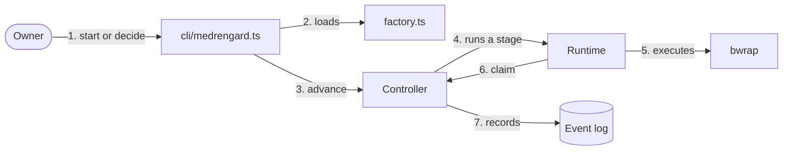

# Guide

This guide explains how Medrengard fits together. It is for a developer joining
the project or anyone curious enough to try it. It explains; it does not set
rules. Install and run commands are in the [README](../README.md). The rules
the core must keep are in [core.md](core.md), which wins wherever this guide
disagrees. Who can read, write or reach the network is in the
[threat model](security/threat-model.md).

## Words

- A **work** is one piece of work, such as an idea on its way to a PR, with an
  id like `3f9c2a1b`.
- A **workflow** is a graph of **stages** that a work moves through. Each stage
  ends with an **outcome** (`done`, `PASS`, `accept`), and the outcome picks
  the next stage.
- An **agent** stage runs an **agent**: role text, skills, MCP servers and a
  **sandbox**, run by a **runtime** such as headless Claude Code. A **command**
  stage runs a check command or an extension function. A **human** stage waits
  for the owner to **decide**.
- Each automatic stage produces an **artifact**: a **document** (a plan), a
  **commit** or a **verdict** (`PASS` or `FAIL` with findings). Whatever an
  agent returns is a **claim** until the controller has checked it.
- The **subject** is what the work is currently about: the latest document's
  hash or the latest commit's SHA. Verdicts and decisions must name it.
- The **event log** is an SQLite table, and the record of everything. The
  current state of a work is rebuilt from it on every read. An **observer** is
  a callback that sees each event as it is written and cannot change anything.

## The shape

| Path | Owns |
| --- | --- |
| [`src/index.ts`](../src/index.ts) | The public entry point. Code outside `src/` imports only this ([`tests/boundary.test.ts`](../tests/boundary.test.ts)). |
| [`src/primitives.ts`](../src/primitives.ts) | The types, [`checkWorkflow`](../src/index.ts) and the [`Controller`](../src/index.ts): the event log, replay, budgets, claim checks, the work's clone, retained commits and read-only snapshots. |
| [`src/sandbox.ts`](../src/sandbox.ts) | Bubblewrap: mounts, environment, network, output caps and killing. It is not exported; stages reach it through `StageContext.execute`. |
| [`src/command-runtime.ts`](../src/command-runtime.ts) | [`commandRuntime`](../src/index.ts), a runtime for any local process that speaks JSON on stdin and stdout. |
| [`extensions/claude-code`](../extensions/claude-code/index.ts) | `claudeCodeRuntime`, which runs `claude -p` and returns its final message as a document. |
| [`workflows/default.ts`](../workflows/default.ts) | `defaultWorkflows`, the shipped idea-to-PR policy, and `examplePlanner`, which builds a planner agent from [`workflows/example/`](../workflows/example/planner.md). |
| [`cli/medrengard.ts`](../cli/medrengard.ts) | `start`, `show` and `decide` against the `factory.ts` in the current directory. |
| [`tests/`](../tests/e2e/mvp.test.ts) | The proof. `tests/e2e/` drives the controller through the entry point with stub agents; the rest cover the sandbox, the runtimes, the CLI and these docs. |

Your factory, the directory holding `factory.ts`, sits outside this checkout
and imports the core the same way any other caller does.

## One run

From the owner's command to the event log:

The CLI builds a `Controller` from the factory's options. For each automatic
stage the controller repeats steps 4 to 7: it records `started`, hands the
runtime a context whose `execute` runs commands in bubblewrap, checks the
claim the runtime returns, and records `completed` or `escalated`. It stops at
a human stage, `DONE` or `ESCALATED`, and the owner's `decide` starts it again.

Command stages have no runtime: the controller calls `context.execute` with
the stage's argv and turns exit code 0 into `PASS` and anything else into
`FAIL`. A stage with `extension` calls the owner's function with the same
`context`. A command stage needs a commit as its subject, otherwise it escalates;
an extension stage does not.

`Controller.advance` loops until the work reaches a human stage, `DONE` or
`ESCALATED`. Before each run it escalates instead when the stage's budget is
spent, or when the stage already failed on this subject and the owner has not
decided since. If anything goes wrong during a run (a thrown error, an unknown
outcome, a claim that fails its check, the stage deadline), the work escalates
with the reason. Nothing is retried.

### What a stage sees

`StageContext.execute` runs a command in bubblewrap, with its working directory
chosen by the stage:

| Stage | Directory | Writable |
| --- | --- | --- |
| Produces a commit (develop, fix) | The work's clone of the owner repository, made the first time a stage needs it | Yes |
| Any other stage while a commit is the subject (check, review, PR) | A fresh snapshot of that commit's files, without `.git` | No |
| `workspace: 'repository'` before any commit (design) | The work's clone | No |
| Anything else | The work's directory: empty unless an earlier stage cloned into it | No |

Agent stages run under their agent's `sandbox`; command and extension stages
run under a bare one. The [threat model](security/threat-model.md#trust-boundaries)
says what each can read and reach.

### Checking a claim

Every result must be JSON under 1 MiB with an `outcome` that names one of the
stage's edges and an `artifact` of the kind the stage `produces`, if it declares one. A document
must have content. A commit's SHA must be the clone's `HEAD` and differ from
the current subject; its objects are then copied into a separate repository,
so the candidate cannot rewrite them later. A verdict must name the current
subject, and its `PASS` or `FAIL` must equal the outcome. Each stored artifact
is hashed.

### Subject, evidence and decisions

A commit becomes the subject. So does a document, unless it names a `subject`
itself, as a PR link does. A verdict is evidence about the current subject.
`State.evidence` lists only the artifacts about the current subject, so a new
commit drops the old reviews.

`decide` checks that the work is at a human stage and that the hash or SHA you
pass is the current subject; otherwise it refuses with `stale owner decision`.
An outcome with no edge is refused too. Feedback given with the decision
reaches the next agent runs as `AgentRequest.feedback`, until the next decision.

### Budgets and handoffs

Each `started` event spends one attempt at that stage. When a stage's spent
count reaches its `budget`, the work escalates. An edge can be a list, such as
`FAIL: ['fix', 'ESCALATED']`, which picks the first entry on the first attempt
and the second on the second. An edge to `{ workflow: 'develop' }` hands the work
to another workflow and resets its spending. The constructor refuses a cycle
of handoffs from automatic stages, so only an owner decision can lead back to a
fresh budget.

### Replay and recovery

`state` replays the work's events each time it is called, and there is no
other copy of the state. If the controller dies mid-run, `recover` escalates
the pending run instead of starting it again; see
[core.md](core.md#invariants).

## Building a factory

A factory is a directory, outside this checkout, that holds your trusted
`factory.ts`. The owner's factory, `~/dev/medrengard-factory`, is the worked
example here. It takes an idea about one repository to an approved plan.
[`tests/cli.test.ts`](../tests/cli.test.ts) builds the same shape with a fake
planner, which is the version the suite actually runs.

### Layout

| Entry | Role |
| --- | --- |
| `factory.ts` | Default-exports `{ options, workflow }`: the controller [`Options`](../src/index.ts) and the name of the workflow `start` opens. |
| `package.json` | An `imports` map: `#medrengard` is the core's entry point through `.medrengard`, and `#medrengard/*` the rest of the checkout, so the factory can import `extensions/` and `workflows/`. |
| `.medrengard` | A symlink to this checkout, ignored by Git. |
| `state/` | Holds `events.sqlite`, the factory's event log, ignored by Git. |

Run directories (`Options.directory`) live under `/var/tmp/medrengard-factory/runs`,
outside `$HOME`, so no instructions file in a parent directory is mistaken for
the clone's own.
The README covers [running it](../README.md#run-it).

### Options

`Options` has a few fields:

- `path`: the event database.
- `directory`: where clones and snapshots go.
- `repository`: the owner repository that works clone.
- `workflows`: the stage graphs.
- `agents`: agents by name.
- `runtimes`: runtimes by name.
- `extensions`: stage functions by name.
- `deadlineMs`: the wall-clock limit for one stage run. The default is 30 seconds;
  the factory sets 30 minutes because a planner takes minutes.

The constructor checks the workflows, agents, runtimes, extensions and
sandboxes before any work starts. It also refuses to
open an event log whose works were opened under different workflow
definitions; see [Changing a workflow](#changing-a-workflow).

### Workflows

A [`Workflow`](../src/index.ts) is a name, a `start` stage and named
[`Stage`](../src/index.ts)s. The factory's `plan` workflow has two stages:
`design` runs the planner agent on a read-only clone (`workspace: 'repository'`)
and produces a document, and `approve` is a human stage whose `accept` ends the
work, `changes` restarts `plan` with a fresh budget, and `reject` escalates.

Each stage declares:

- `kind`: `agent`, `command` or `human`.
- What runs: `agent` (a key of `agents`); `command` (an argv); or `extension`
  (a key of `extensions`), on a `command` stage.
- `produces`: `document`, `commit` or `verdict`. Agent stages must declare it.
- `budget`: a positive whole number of attempts. Required except on human
  stages.
- `on`: outcome names mapped to a stage, `DONE`, `ESCALATED`, a list of those
  picked by attempt, or `{ workflow }` to hand off.

[`checkWorkflow`](../src/index.ts) returns the errors for one workflow without
building a controller. [`workflows/default.ts`](../workflows/default.ts) is the
full idea-to-PR policy: `design`, then `develop` with a check, up to two
standard reviews with one fix between them, one adversarial review, an owner gate and a `pr` extension. The
factory's `plan` is its `design` half, with `accept` ending the work until
develop has real agents.

### Agents and sandboxes

An [`Agent`](../src/index.ts) names its runtime and carries `role` text,
`skills`, `mcpServers` and a `sandbox`. Runtime, model and role are chosen
independently: the factory's `designer` comes from `examplePlanner`, which
joins [`planner.md`](../workflows/example/planner.md) and
[`guide.md`](../workflows/example/guide.md) as the role and adds the
[plan skill](../workflows/example/plan-skill/skills/plan/SKILL.md) as a Claude
Code plugin. Change the role and the runtime stays the same; change the runtime
and the role stays the same.

The sandbox is `backend: 'bwrap'` plus `read` (absolute paths to mount
read-only, such as the `claude` binary), `network` (the host network, off
unless `true`) and `env` (names of variables to copy in, which must be set when
the controller starts). The factory's planner declares all three, to reach the
model with a subscription token; what that exposes, and why it is accepted for
now, is in the [threat model](security/threat-model.md#repository-agent-with-network-and-token).

### Runtimes

A [`Runtime`](../src/index.ts) has four methods: `start(request, context)`
begins a run; `events(runId)` yields progress, each recorded as a `runtime`
event; `result(runId)` returns the claim, `{ outcome, artifact }`; `cancel(runId)`
stops it. Anything it executes for the candidate must go through
`context.execute`, which is the sandbox. Three exist:

- [`commandRuntime`](../src/index.ts)`(argv)`: any local program that reads the
  request and artifacts as JSON on stdin and writes the result as JSON on
  stdout. [`tests/e2e/contracts.test.ts`](../tests/e2e/contracts.test.ts) runs
  such programs.
- `claudeCodeRuntime({ command, settingSources, model })`: headless
  `claude -p` with read-only tools (`Read`, `Grep`, `Glob`, `Skill`). It turns
  the final message into a document, so it can plan but not commit or review.
  It refuses agents with MCP servers.
- Your own. The stub in the `setup` of
  [`tests/default-workflow.test.ts`](../tests/default-workflow.test.ts) is a
  short, complete example: it commits through `context.execute` for the
  developer and returns verdicts for reviewers.

### Extensions

An extension is a function `(context) => Promise<{ outcome, artifact }>` in
`Options.extensions`, run by a `command` stage that names it. It is trusted
code in the controller's process; it receives the subject and every artifact
so far, and anything it executes through `context.execute` runs in a bare
sandbox. The `pr` extension in the same `setup` returns a document whose
`subject` is the reviewed SHA, so the link is evidence rather than a new
subject.

### Observers

`controller.observe(fn)` calls `fn` with each event as it is written; it
cannot change state. The CLI does not expose it, so use it from your own
script around `Controller`, as the [README](../README.md#use-the-primitives)
does.

### Recipes

**A new repository.** Point `repository` at it. If the runtime loads project
settings (`settingSources: ['project']`), the repository's `.claude/` hooks
run inside the planner's sandbox with its network and token: only do this for
a repository you trust. Add any toolchain outside the system directories
(`/usr`, `/opt` and the like) to the agents' `sandbox.read`.

**A new stage.** Add it to the workflow with its kind, implementation,
`produces`, `budget` and edges, and point an existing edge at it. A new agent
goes in `agents`, a new extension in `extensions`. A `command` stage only runs
when a commit is the subject, so `plan` cannot gain a check until it has a
developer. Try it with a fake runtime first, as `tests/cli.test.ts` does; a
paid run follows [live runs](live-runs.md).

### Changing a workflow

Each `opened` event records a hash of all workflow definitions. Once you
change any workflow, the controller refuses that database with `workflow
definitions changed since the recorded run`. Move `events.sqlite` aside,
or point `path` at a new file, and start new works. Changing agents,
runtimes or extensions does not trigger this.

### What is not there yet

Real developer and reviewer agents, a check command for a real repository and
publishing a PR are the next ticket ([STATUS](STATUS.md)); the
[roadmap](roadmap.md) lists what follows.
