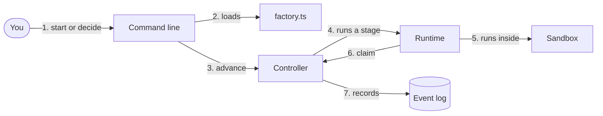

# Guide

This guide explains how Medrengard works. It has three parts:

1. **[How it works](#how-it-works)**, for anyone curious. It needs no coding.
2. **[Building a factory](#building-a-factory)**, for setting Medrengard up
   on your own project. It assumes you can read a little TypeScript.
3. **[Changing the core](#changing-the-core)**, for developers working on
   Medrengard itself.

To install and run it, see the [README](../README.md). The rules the core must
always keep are in [core.md](core.md); if this guide ever disagrees with it,
core.md is right. Who can see, change or reach what is in the
[threat model](security/threat-model.md).

## How it works

### Words

- A **work** is one job on its way through Medrengard, such as "remove the
  hit sound from rifle hits". Each has a short id like `3f9c2a1b`.
- A **workflow** is the list of steps a work goes through. Each step is a
  **stage**. A stage ends with an **outcome**, a short word such as `done`,
  `PASS` or `accept`, and the workflow says which stage each outcome leads to.
- There are three kinds of stage:
  - an **agent** stage hands the job to an AI agent, such as Claude Code;
  - a **command** stage runs a fixed check, such as the project's tests, or a
    small piece of the owner's own code, called an **extension**;
  - a **human** stage waits for the **owner**, you, to **decide**.
- Each automatic stage produces an **artifact**: a **document** such as a
  plan, a **commit** (a saved version of the code), or a **verdict** (`PASS` or
  `FAIL`, with findings).
- What an agent hands back is only a **claim** until Medrengard has checked
  it.
- The **subject** is what the work is currently about: the latest plan or the
  latest version of the code. Each is identified by a fingerprint, a long
  string of letters and digits that changes if a single character changes: a
  **hash** for a document, a **SHA** for a commit.
- A **budget** is how many times a stage may run before Medrengard stops and
  asks you.
- The **event log** is a small database file recording every step. Medrengard
  works out where each work stands by reading it from the beginning.

### A work from start to finish

The owner's factory plans changes to one of the owner's projects:

1. You run `start` with an idea.
2. Medrengard makes a private copy of the project's code and lets the planner
   agent (Claude Code) read it, inside a sandbox: a fence that lets the agent
   see and reach only what the factory allows.
3. The planner writes a plan. Medrengard checks that it is a real document,
   records it with its fingerprint, and moves to the next stage: asking you.
4. You read the plan and either `accept` it or ask for `changes`, with
   feedback. Either way you quote the plan's fingerprint, so you can only
   decide on the version you actually read.
5. After `changes`, the planner runs again with your feedback and its previous
   plan, and you are asked again.
6. After `accept`, a developer agent writes the code in the private copy and
   Medrengard commits it. The project's tests run on exactly that commit, then
   a reviewer and an adversarial reviewer look at it. A failed check or review
   goes back to the developer to fix, a limited number of times.
7. You get the commit with every verdict and its findings. `accept` opens a
   draft pull request; `changes` sends it back with your feedback for another
   round.

The factory has run steps 1 to 5 for real; the whole run has been tested with
stand-in agents and is ready for its first real run ([STATUS](STATUS.md)).

Behind the commands, the pieces fit together like this:

The command line reads your factory's settings and starts the **controller**,
the part of Medrengard that decides what happens next. For each automatic
stage, the controller hands the job to a **runtime**, the adapter for one kind
of agent, which runs it inside the sandbox. The runtime returns a claim; the
controller checks it and records the result. This repeats until the work
needs you, is done, or has stopped with a reason, which is called
**escalated**.

### What Medrengard will not do

- **Retry on its own.** If anything goes wrong (an error, an outcome the
  workflow does not expect, a claim that fails its check, a stage that runs
  too long or a budget used up), the work stops and the reason is recorded.
- **Rerun a failed check or review on the same code.** That needs new code or
  your decision.
- **Accept a decision about a version you were not shown.** If the plan or
  code has changed, `decide` is refused with `stale owner decision`.
- **Let a review of old code count for new code.** A new commit leaves the old
  reviews behind.
- **Let anything but the controller change the record.** Agents, checks and
  observers can only hand back claims or read events.
- **Restart a step that was cut off.** If Medrengard is stopped in the middle
  of a step, recovery marks the work as needing you instead of running it
  again.

### What each stage can see

Each stage can declare its `access`; without it, it gets these defaults:

| Stage | Works in | Can change it |
| --- | --- | --- |
| One that writes code (develop, fix) | The work's private copy of the project, made the first time a stage needs it | Yes |
| Any other stage once there is code to look at (checks, reviews, the PR step) | A fresh copy of exactly that version's files with its Git history, so `git diff <base> HEAD` shows the change, thrown away afterwards | Yes |
| One that reads the project before any code is written (design, declared with `workspace: 'repository'`) | The work's private copy | No, so it cannot change what the developer starts from |
| Anything else | A new empty folder | Yes |

Every process can also write its own private `/tmp`, which is gone when it
ends. A stage gets only the paths, network access and secrets its agent's
sandbox and its own `access` grant. The
[threat model](security/threat-model.md#trust-boundaries) has the details.

## Building a factory

A factory is a folder of your own, outside this checkout, holding a
`factory.ts` that Medrengard trusts. The owner's factory,
`~/dev/medrengard-factory`, is the worked example here: it takes an idea about
one repository through an approved plan, development, a check and reviews to a
draft pull request. The same shape, with fake agents, is built by
[`tests/cli.test.ts`](../tests/cli.test.ts), which is the version the tests
actually run.

### What is in this checkout

| Path | What it is |
| --- | --- |
| [`src/index.ts`](../src/index.ts) | The core's front door. Everything outside `src/`, your factory included, imports only this. |
| [`src/primitives.ts`](../src/primitives.ts) | The [`Controller`](../src/index.ts), [`checkWorkflow`](../src/index.ts) and the types. |
| [`src/sandbox.ts`](../src/sandbox.ts) | The sandbox, built on bubblewrap, a Linux tool that fences a program in. Stages use it through `StageContext.execute`. |
| [`src/command-runtime.ts`](../src/command-runtime.ts) | [`commandRuntime`](../src/index.ts), a runtime for any local program that speaks JSON. |
| [`extensions/claude-code`](../extensions/claude-code/index.ts) | `claudeCodeRuntime`, the Claude Code runtime, and its `defaultPrompt`. |
| [`extensions/command-check`](../extensions/command-check/index.ts) | `commandCheck`, a check that runs a command. |
| [`extensions/github`](../extensions/github/index.ts) | `githubPullRequest`, which publishes the accepted commit as a draft PR. |
| [`workflows/default.ts`](../workflows/default.ts) | `defaultWorkflows`, the idea-to-PR workflow, and the example planner, developer, reviewer and adversarial reviewer agents, built from [`workflows/example/`](../workflows/example/planner.md). |
| [`cli/medrengard.ts`](../cli/medrengard.ts) | The command line: `start`, `show`, `decide` and `recover`, using the `factory.ts` in the current folder. It is also the first observer: it prints each stage's start and result as they are recorded. |
| [`tests/`](../tests/e2e/mvp.test.ts) | The tests, which double as worked examples. |

### What the default gives you, and what your factory adds

Medrengard ships the policy most factories share, and leaves out everything
that is about you, your machine or your project. The owner's factory imports
the shipped workflow unchanged and supplies the rest:

| Medrengard ships | The factory supplies |
| --- | --- |
| The workflow, `defaultWorkflows`: stages, routes, budgets and the owner's gates | The repository to work on |
| The example agents: their roles, the shared workflow guide and the plan skill | Each agent's sandbox: network, the token by name, and read access to `claude` and `node` |
| `claudeCodeRuntime` | Its settings: the model, and project settings for a trusted repository |
| `commandCheck`, a check that runs a command | The command it runs and what it can reach (`defaultWorkflows({ check })`) |
| `githubPullRequest` | The repository it publishes from |
| The controller and the CLI | Where the event log and working copies live, and the stage deadline |

Importing keeps the factory current: a change to the default reaches it on the
next run, once its event log is replaced (see
[Changing a workflow](#changing-a-workflow)). To diverge, either change a
piece and keep the shape (other agents, another check, a wrapped
`defaultPrompt`, one stage replaced in the array `defaultWorkflows()`
returns), or copy the workflow into `factory.ts` and own it. To the controller
a workflow is only data, so both are equally supported. The factory's own
README says what it runs and how; this section is the explanation it links to.

### The factory's files

| Entry | What it is |
| --- | --- |
| `README.md` | What this factory runs and how to run it, linking here for the explanation. |
| `factory.ts` | Default-exports `{ options, workflow }`: the controller's [`Options`](../src/index.ts) and the name of the workflow `start` opens. |
| `package.json` | An `imports` map: `#medrengard` is the core's front door through `.medrengard`, and `#medrengard/*` the rest of the checkout, so the factory can import `extensions/` and `workflows/`. |
| `.medrengard` | A symlink to this checkout, ignored by Git. |
| `state/` | Holds `full.sqlite`, the factory's event log, ignored by Git, and `events.sqlite`, the log of the planning-only runs before it. |

Its working copies (`Options.directory`) live under
`/var/tmp/medrengard-factory/runs`, outside your home folder, so that no
instructions file in a parent folder is mistaken for the project's own. The
README shows how to [run it](../README.md#run-it).

### Options

`Options` has a few fields:

- `path`: the event log file.
- `directory`: where working copies go.
- `repository`: the project that works copy.
- `workflows`: the workflows.
- `agents`: agents by name.
- `runtimes`: runtimes by name.
- `extensions`: extension functions by name.
- `deadlineMs`: how long one stage may run, in milliseconds. The default is 30
  seconds; the factory sets 60 minutes, because a developer installs, edits
  and tests.

When the controller starts, it checks the workflows, agents, runtimes,
extensions and sandboxes before any work begins. It also refuses an event log
whose works were started under different workflows; see
[Changing a workflow](#changing-a-workflow).

### Workflows

A [`Workflow`](../src/index.ts) is a name, a `start` stage and named
[`Stage`](../src/index.ts)s. The factory uses the shipped default, described
below. Its `design` workflow has two stages. `design` runs the planner agent on
a read-only copy of the project (`access: { workspace: 'repository' }`) and
produces a document. `approve` is a human stage: `accept` hands over to the
`develop` workflow, `changes` starts `design` again with a fresh budget, and
`reject` escalates.

Each stage declares:

- `kind`: `agent`, `command` or `human`.
- What runs: `agent` (a name in `agents`), or on a `command` stage
  `extension` (a name in `extensions`). A command stage is your own code; an
  agent stage hands a request to a runtime.
- `produces`: `document`, `commit` or `verdict`. Agent stages must say.
- `access`: what the stage's processes can reach, on top of its agent's
  sandbox. `workspace` is `repository` (the work's copy of the project),
  `subject` (a fresh copy of the current commit) or `empty`. `write` is `none`
  (only `/tmp`), `scratch` (also a folder of its own that is kept after the
  run, at `$MEDRENGARD_SCRATCH`) or `full` (also the workspace). `history:
  false` leaves Git history out of a `subject` copy. `read`,
  `network` and `env` work as in a sandbox. Unset fields take the defaults in
  [What each stage can see](#what-each-stage-can-see); a stage that writes
  code must keep the writable copy of the project.
- `budget`: how many attempts it gets, a positive whole number. Every stage
  except a human one needs it.
- `on`: each outcome mapped to where it leads: another stage, `DONE`,
  `ESCALATED`, `{ workflow }` to hand over to another workflow, or a list of
  these chosen by attempt. `FAIL: ['fix', 'ESCALATED']` goes to `fix` after the
  first attempt and escalates after the second.

Handing over to another workflow resets the budgets. To stop budgets resetting
themselves in a loop, Medrengard refuses a cycle of hand-overs made by
automatic stages, so only your decision can lead back round.
[`checkWorkflow`](../src/index.ts) lists a workflow's mistakes without starting
anything.

[`workflows/default.ts`](../workflows/default.ts) is the full idea-to-PR
workflow: `design`, then `develop`, a `check` extension, a standard review and
an adversarial review, your decision and a `pr` extension. A failed check gets
up to two fixes and a failed standard review one; a failure that would end the
run comes to your `owner` decision instead, with its findings, and the budgets
are sized so that happens before any of them runs out. One round costs at most
seven paid agent runs: the develop run, three fixes and three reviews. A
commit whose developer reports a departure from the plan stops at
`deviation` before it is checked: `proceed`, `changes` or `reject`. At
`owner`, `accept` publishes, `changes` starts a fresh round with your feedback
and `reject` ends the work. The factory passes the check's access to
`defaultWorkflows({ check })`: its `node` install and the network, so
`commandCheck` can run `npm ci`, the tests and the typecheck on each commit.

### Agents and sandboxes

An [`Agent`](../src/index.ts) names its runtime and carries its `role` text,
`skills`, `mcpServers` and `sandbox`. The runtime, the model and the role are
chosen separately. The factory's `designer` comes from `examplePlanner`, which
uses [`planner.md`](../workflows/example/planner.md) and
[`guide.md`](../workflows/example/guide.md) as the role and adds the
[plan skill](../workflows/example/plan-skill/skills/plan/SKILL.md) as a Claude
Code plugin. You can change the role without touching the runtime, and the
other way round.

The sandbox is `backend: 'bwrap'` plus three optional settings. `read` lists
folders and files the agent may read, such as the `claude` program. `network`
gives it the network when `true`. `env` names secrets or settings to pass in
from your shell, each of which must be set when the controller starts. The
factory's agents use all three, so that they can reach the model with a
subscription token and run `node` for the tests. What that exposes, and why it fits the owner's risk
appetite, is in the [threat model](security/threat-model.md#agents-with-network-and-a-token).

### Runtimes

A [`Runtime`](../src/index.ts) has four methods: `start(request, context)`
begins a run, `events(runId)` reports progress (each report is recorded as it
comes, so it is kept even if the run is cut off), `result(runId)` returns the
claim, `{ outcome, artifact }`, and `cancel(runId)` stops it. The request says
what the stage `produces`. Anything it runs for the agent must go through
`context.execute`, which is the sandbox; its `onStdout` option hands over
output as it arrives. There are three choices:

- [`commandRuntime`](../src/index.ts)`(argv)`: any local program that reads the
  request as JSON and writes its result as JSON.
  [`tests/e2e/contracts.test.ts`](../tests/e2e/contracts.test.ts) runs such
  programs.
- `claudeCodeRuntime({ command, settingSources, model, tools, prompt, commit,
  author })`: headless Claude Code. What it returns follows what the stage
  `produces`. For a document, the final message. For a commit, it asks
  with `--json-schema` for a commit `message`, a `report` for you and a list
  of `deviations` from the plan, then commits whatever the agent left in the
  copy of the project as `author` with that message, keeps the report (and
  any deviations) as the commit's content, and returns the outcome `deviated`
  instead of `done` if there were any; `commit: 'agent'` lets the agent commit
  for itself instead. For a verdict, a `PASS` or `FAIL` with the findings that
  must be fixed and a `summary` for you, bound to the commit under review. Planners get
  `Read`, `Grep`, `Glob` and `Skill`; reviewers also `Bash`; developers also
  `Edit` and `Write`, all with permissions bypassed because the sandbox is the
  boundary; `tools` replaces a set. `defaultPrompt` gives the idea, the plan,
  what failed on the current commit, what is already recorded for the commit
  under review, the change to review and your feedback;
  `prompt` replaces or wraps it. The whole `stream-json` session is recorded as
  runtime events. It refuses agents that declare MCP servers.
- Your own. The stub in the `setup` of
  [`tests/default-workflow.test.ts`](../tests/default-workflow.test.ts) is a
  short, complete example: it commits through `context.execute` for the
  developer and returns verdicts for the reviewers.

[How a claim is checked](#how-a-claim-is-checked) lists what the controller
accepts.

### Extensions

An extension is a function `(context) => Promise<{ outcome, artifact }>` in
`Options.extensions`, run by a `command` stage that names it. It runs inside
Medrengard as trusted code. Its `context` holds the `work` ID, the `subject`,
the `base` commit the work's copy of the project started from, the run's
`scratch` folder if it has one, and every artifact so far.
Anything it runs through `context.execute` gets the stage's `access`.
[`commandCheck`](../extensions/command-check/index.ts)`(argv)` is the shipped
check: it runs a command and turns exit code 0 into `PASS` and anything else
into `FAIL`, keeping the output.
[`githubPullRequest`](../extensions/github/index.ts)`({ repository })` is the
shipped publisher. It uses your own `git` and `gh`: it pushes the accepted
commit from Medrengard's stored copy to `medrengard/<work>` on your
repository's remote, then opens a draft PR with the change, the evidence and
the plan, or updates the open PR on that branch, so publishing again never
opens a second one. The `pr` extension in the same `setup` returns a document whose
`subject` is the reviewed SHA, so the link counts as evidence about that code
rather than as a new subject.

### Observers

`controller.observe(fn)` calls `fn` with each event as it is recorded; it
cannot change anything. The command line does not offer it, so use it from
your own script, as
[`tests/e2e/observation.test.ts`](../tests/e2e/observation.test.ts) does.

### Recipes

**A new repository.** Point `repository` at it. If the runtime loads the
project's own Claude Code settings (`settingSources: ['project']`), the
project's hooks run inside the planner's sandbox with its network and token,
so do this only for a project you trust. If its tools live outside the system
folders (`/usr`, `/opt` and the like), add them to the agents' `sandbox.read`.

**A new stage.** Add it to the workflow with its kind, what runs, `produces`,
`budget` and `on`, and point an existing outcome at it. A new agent goes in
`agents`, a new extension in `extensions`. A `command` stage only runs once
there is a commit, so `plan` cannot gain a check until it has a developer. Try
it with a fake runtime first, as `tests/cli.test.ts` does. A run with a paid
model follows [live runs](live-runs.md).

### Changing a workflow

Each work records a fingerprint of all the workflows when it starts. Once you
change any workflow, the controller refuses that event log with `workflow
definitions changed since the recorded run`. Move `events.sqlite` aside, or
point `path` at a new file, and start new works. Changing agents, runtimes or
extensions does not trigger this.

### What is not there yet

The full run has not yet been made with real agents; that is the next action
([STATUS](STATUS.md)). The [roadmap](roadmap.md) lists what follows.

## Changing the core

### How the controller decides

`Controller.advance` runs automatic stages until the work reaches a human
stage, `DONE` or `ESCALATED`. Before each run it escalates instead if the
stage's budget is spent, or if the stage already failed on this subject and
the owner has not decided since. Each `started` event spends one attempt and
records the run's scratch folder, if it has one. A stage whose `access` asks
for a `subject` copy before there is a commit escalates.

#### How a claim is checked

Every result must be JSON under 1 MiB, with an `outcome` the stage has an edge
for and an `artifact` of the kind the stage `produces`, if it declares one. A
document must have content. A commit's SHA must be the working copy's `HEAD`
and differ from the current subject; its objects are then copied into a
separate repository, so the agent cannot rewrite them later. A verdict must
name the current subject, and its `PASS` or `FAIL` must match the outcome.
Each stored artifact is hashed.

#### Subject and evidence

A commit becomes the subject. So does a document, unless it names a `subject`
itself, as the PR link does. A verdict is evidence about the current subject.
`State.evidence` lists only artifacts about the current subject. `decide`
checks that the work is at a human stage, that the subject given is current
and that the outcome has an edge. Its feedback reaches later agent runs as
`AgentRequest.feedback` until the next decision.

#### Replay and recovery

`state` replays the work's events every time; there is no other copy of the
state. `recover` escalates a run that was cut off instead of starting it again
([core.md](core.md#invariants)).

### Where the rules live

Almost everything is in [`src/primitives.ts`](../src/primitives.ts), named
here by symbol:

| Rule | Symbol |
| --- | --- |
| A workflow's shape: kinds, finite budgets, edges to real stages | `checkWorkflow` |
| References across definitions, handoff cycles, sandbox checks, refusing a changed or legacy database | the `Controller` constructor |
| Replaying events into `State`; which artifacts are evidence | `#read` |
| Appending an event only if the work has not changed since it was read, then notifying observers | `#write` |
| Picking the next stage from an outcome and the attempt count | `#edge` |
| The stage loop: budgets, the failed-gate rule, clones and snapshots, `StageContext`, the deadline, escalation | `advance` |
| Checking a claim | `#artifact` |
| Copying a commit's objects out of the agent's reach | `#retain`, and `SNAPSHOT` to materialize one |
| Owner decisions and crash recovery | `decide`, `recover` |

[`src/sandbox.ts`](../src/sandbox.ts) builds the bubblewrap command (`wrap`,
`binds`, `environment`), validates sandboxes and probes bwrap
(`checkSandbox`), and runs, caps and kills the process (`execute`).

### Mechanism or policy

The core holds mechanism; workflows and extensions hold policy
([core.md](core.md#policy-not-core)). A useful test: if two owners could
reasonably want different answers, such as how many reviews, which roles or
what a PR contains, it is policy and belongs in a workflow, an agent or an
extension. A core change must keep every [invariant](core.md#invariants), and
an extension point is built only once something the owner runs needs it
(A-113 and A-124 in [decisions](decisions.md)).

### The front door

[`src/index.ts`](../src/index.ts) is the whole public API. Everything that
ships outside `src/` (`workflows/`, `extensions/`, `cli/`, `scripts/`) imports
only that file, and [`tests/boundary.test.ts`](../tests/boundary.test.ts)
fails otherwise. Tests may reach inside; most do not. A new public name is an
export there, and a doc that links the name to `src/index.ts` is checked by
[`tests/docs.test.ts`](../tests/docs.test.ts).

### Test patterns

Nothing calls a paid model. Each pattern has a file to copy:

| To prove | Copy |
| --- | --- |
| A workflow behaviour, end to end through the front door | [`tests/e2e/mvp.test.ts`](../tests/e2e/mvp.test.ts): a `Stub` runtime, a real Git repository and bwrap, one test per case |
| A runtime keeps the contract | [`tests/e2e/contracts.test.ts`](../tests/e2e/contracts.test.ts): the same tests over a fake and `commandRuntime` |
| Observers cannot change anything | [`tests/e2e/observation.test.ts`](../tests/e2e/observation.test.ts) |
| A sandbox guarantee | [`tests/sandbox.test.ts`](../tests/sandbox.test.ts) on `execute` directly; [`tests/confinement.test.ts`](../tests/confinement.test.ts) for processes outliving their stage |
| An adapter's arguments and parsing | [`tests/claude-code.test.ts`](../tests/claude-code.test.ts): a fake `claude` script that reports its arguments |
| The command line | [`tests/cli.test.ts`](../tests/cli.test.ts): a factory written to a temporary folder |
| The shipped workflow | [`tests/default-workflow.test.ts`](../tests/default-workflow.test.ts) |

Run `npm test`; [AGENTS.md](../AGENTS.md) gives the command for the real
bubblewrap tests. Unit tests are kept for genuine branching logic only.

### Adding a primitive

1. Check it against [core.md](core.md): which goal it serves, which invariant
   it touches, and whether it is policy in disguise.
2. Write the failing test first, through `src/index.ts` only, usually as a
   new numbered case in `tests/e2e/`.
3. Implement it in `src/`, and export any new public name from
   `src/index.ts`.
4. Update the one doc that owns the fact: `core.md` for a rule, the threat
   model for a permission, the README for how to run it, this guide for how
   it works.
5. Run the suite. The owner merges with `git merge --no-ff`, which runs
   [`scripts/pre-merge-commit`](../scripts/pre-merge-commit) on the merge
   result.
